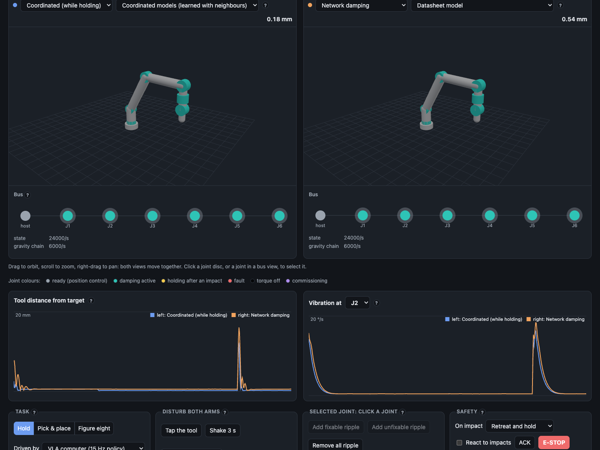
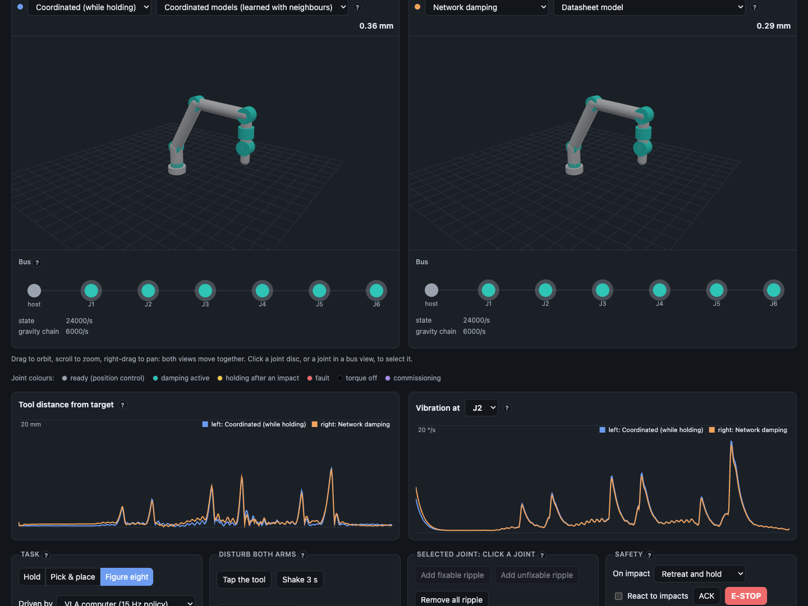

# NoASim

[](https://github.com/kognexus/NoASim/actions/workflows/ci.yml)

**A simulation of robot joints that work as a team.**

Each actuator of a six-joint arm carries its own processor, encoders, motion sensor and
safety path. Every 250 µs the joints share what they sense over an EtherCAT-like bus. With
that shared data they damp vibration, take the sag out of flexible links, find the joint
that causes a disturbance, stop the whole arm when any one of them feels an impact, compute
gravity from their own sensors, and turn the sparse goals of a slow AI policy into smooth
motion. The robot's main computer only sends goals, limits and settings.



The joint code is real, not scripted. Each joint is a separate WebAssembly instance of a
`no_std` Rust crate shaped like actuator firmware. It sees only its own sensors and the
bus frames sent to it, and a test checks that nothing else can reach it.

## The report

**[Read the final report](docs/REPORT.md)**: what we built, the mathematics, the setup,
every test, the results and what they mean for a network of actuators. The highlights:

| | Result |
|---|---|
| Host workload | The host sends **30 times fewer** messages when the joints plan their own motion between goals. |
| Learned actuator models | On budget actuators, each joint's learned model of itself cuts drift from the ideal arm **6.2 times**. |
| Coordinated models | Learned from the neighbours, they hold the light arm's tool **5 times closer** to its target and cut its path error by up to **2.7 times**. |
| Coordinated damping | Inside the joints, it holds the tool **1.3 to 2.8 times closer** than network damping after a tap, on a clean bus. |
| Network damping | Settles a tap **2.0 to 2.5 times** faster than the joints' own control. The 10 times target was missed. |
| Safety | Every joint reacts to an impact within **one bus cycle**. Retreat-and-hold, braking stop and the brake check all pass, with no false stops. |
| Fault finding | The network names a faulty joint in **100 of 100** blinded trials. |
| Stability | No joint's network term put more than **1.02 mJ** into the arm, under a 50 mJ budget, with 20 cycles of delay and 20 % lost messages. |

Every number is measured by `npm run prove` against targets set before any code was
written, and missed targets are reported as missed. The full tables are in
[docs/RESULTS.md](docs/RESULTS.md), and what the simulation cannot show is in
[docs/limitations.md](docs/limitations.md).

## Try it

Requirements: Rust (`rustup` installs 1.99 from `rust-toolchain.toml`), Node.js 22 or
newer, and [uv](https://docs.astral.sh/uv/) for the learned models.

```bash
npm install
npm run build:wasm
npm run dev -w web
```

Open the printed address. Two identical arms stand side by side, and each has its own
damping mode and model. Then:

- **Tap the tool** to see how each arm damps the same knock.
- **Pick a task** (hold, pick and place, figure of eight) and a robot computer: a VLA
  policy computer that sends goals 15 times a second, or a classic controller that
  streams setpoints 1,000 times a second.
- **Choose "Coordinated models"** to let each joint correct for its neighbours' motion and
  its link's sag.
- **Click a joint** and give it a torque ripple. With "network + report to source" the
  joint names itself and cancels a fixable ripple, or reports a fault.
- **Collide** to see the impact policy act on every joint at once.



```bash
npm run prove   # measures every hypothesis and writes docs/RESULTS.md (about 45 min)
npm run check   # formats, lints and tests the Rust, TypeScript and Python code
```

## Repository layout

| Path | What it holds |
|---|---|
| `crates/nexus-proto` | Bus frames shared by the joints and the host (Rust, `no_std`), pinned by golden bytes |
| `crates/nexus-node` | Everything one actuator node computes (Rust, `no_std`) |
| `crates/nexus-wasm` | One node per WebAssembly instance (C ABI) |
| `sim/` | The harness: MuJoCo plant, actuator and sensor models, bus, host, scenarios, analyses (TypeScript) |
| `web/` | The interactive demo (Vite, three.js) |
| `experiments/` | `npm run prove`, the tuner and the experiment behind each result |
| `learning/` | Training of each joint's learned models (Python, uv, PyTorch) |
| `models/` | Frozen, versioned per-joint model weights and coordinated-damping designs |
| `docs/` | [Report](docs/REPORT.md), [results](docs/RESULTS.md), [plan](docs/PLAN.md), [architecture](docs/architecture.md), [the learned model](docs/phnn.md), [limitations](docs/limitations.md), decision records in `docs/adr/` |

## How the work is tracked

The plan ([docs/PLAN.md](docs/PLAN.md)) was reviewed before any code was written. Each
work package is a [GitHub issue](https://github.com/kognexus/NoASim/issues) with its
acceptance criteria, its tests and a log of what was found, including what did not work.
Ticket NX-n is issue n + 1, and every commit names its ticket and links to its issue.
The [CHANGELOG](CHANGELOG.md) records what each ticket changed, and decisions are recorded
as ADRs in `docs/adr/`. [Continuous integration](.github/workflows/ci.yml) runs the Rust,
TypeScript and Python checks on every push.

## Licence

Not chosen yet. Until a licence is added, all rights are reserved.
