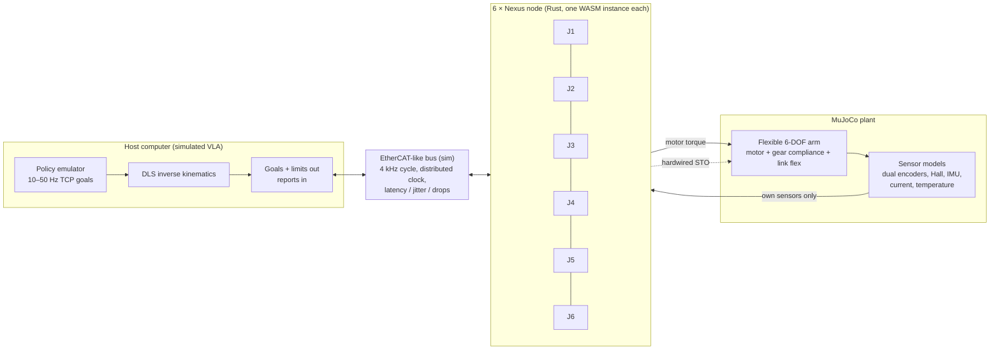

# KognexusNexus: networked-actuator arm simulation

*Approved 21 Oct 2026. Each ticket below has its own file in `docs/tickets/`, and progress is
tracked in `docs/tickets/BOARD.md` and `CHANGELOG.md`.*

## 1. Goal

Show in simulation, with numbers anyone can reproduce, that a 6-DOF arm whose actuators
**compute and coordinate at the joint level** beats the same arm controlled the usual way:
a central computer running a VLA policy, Jacobian IK and interpolation.

There are two outputs:

1. **Proof (headless).** `npm run prove` runs a fixed set of scenarios with fixed seeds,
   checks the hypotheses in §3 as automated tests and writes `docs/RESULTS.md` with plots.
   The numbers come out as they come out. If a target is missed, the report says so.
2. **Demo (interactive).** A browser app built on MuJoCo WASM shows two identical arms side
   by side, one with the network off and one with it on. You can inject vibration, ripple, a
   tap or an impact at any joint and watch both arms react at the same moment.

## 2. System behaviour to model

The three behaviours from the brief, plus the ones from the SPRIND notes (positioning v3,
safety concept, IMU uses) marked **[+]**.

| # | Behaviour | Where it runs |
|---|---|---|
| B0 [+] | **Discovery and topology.** When the bus comes up, nodes enumerate, take addresses, learn their up- and downstream neighbours and swap identity, kinematic parameters and disturbance fingerprint. Plugging or unplugging a node is detected. | Nodes, bus |
| B1a | **Neighbour damping.** A joint that senses vibration arriving from a neighbour adds a damping torque on top of its own task. The joints best placed for the current posture take the largest share, which each joint works out from its own lever arm. | Nodes |
| B1b | **Report to source, then fault.** The damping joint names the source from the disturbance's fingerprint and sends it a report. The source has a deadline (a configurable number of bus cycles) to correct the problem itself, for example with adaptive ripple compensation. If the residual is still above threshold at the deadline, the source registers a fault and reports it to the host. | Nodes, host gets the report |
| B2 | **Impact reaction (user-selected policy).** Any joint whose IMU registers an impact broadcasts `IMPACT{t_detect, joint}` and the whole arm reacts with the policy the host armed (see §2.1). The default trigger is "any joint stops the arm", as specified. A "confirmed by N joints" trigger is available as an option. A hardwired STO line in the sim works even when the bus is down. | Nodes, STO line |
| B3 | **Joint-level interpolation.** The host sends sparse, timestamped goals at the VLA rate (10 to 50 Hz, with jitter and dropouts). Each joint interpolates them at 4 kHz with a jerk-limited profile. All joints share the bus's distributed clock, so they arrive together. Late or missing goals are bridged by extrapolating, then holding. | Nodes |
| B4 [+] | **Flex and torque without a torque sensor.** Gear twist comes from the dual encoders (motor side minus output side). Link flex comes from IMU rate minus encoder rate. Both feed B1 and B5. | Nodes |
| B5 [+] | **Network may only remove energy.** An energy-tank (passivity) guard means the neighbour term can never add energy. Its torque is capped at a small share of rated torque, and it switches off when neighbour data is late, so the joint falls back to damping on its own. The demo shows this with a bus-latency slider: the effect fades gracefully and the arm never goes unstable. | Nodes |
| B6 [+] | **Host limits and announced actions.** The host sets torque, speed, position and temperature limits, and each joint enforces them every cycle. Every action a joint takes on its own (damping, derating, stopping) is announced on the bus in the same cycle, so the host is never surprised. | Nodes |
| B7 [+] | **Thermal headroom.** Each joint models its motor temperature and publishes its headroom in advance. It derates openly and never cuts torque silently. | Nodes |
| B8 [+] | **Comm-loss behaviour.** If the bus watchdog expires, the joint holds position compliantly for a bounded time, then does safe stop 1, then STO. | Nodes |
| B10 [+] | **Gravity compensation from each joint's IMU.** Each joint estimates the gravity direction in its own link frame from its accelerometer, fused with its gyro while moving. The gravity load is then passed **from the tip inward**: each joint receives the mass and centre of mass of everything beyond it from its outer neighbour, adds its own link, computes its own gravity torque and passes the sum inward. No joint needs the whole robot model, and the host does not compute it. When the arm holds still, the measured holding torque (current is a good torque signal in a QDD) gives a **payload estimate**. This works with the base tilted or moving, where a host model that assumes "gravity points down" is wrong. The result is used as feed-forward by every hold (P1, P3, B8) and offered to the host. | Nodes, along the chain |
| B11 | **A learned model of each joint (PHNN).** Each joint learns a port-Hamiltonian model of its own actuator from its own commissioning data, without being told what the actuator is. The model is frozen and used for feed-forward, for the energy the damping law works with and for a residual that sharpens attribution. See §2.2. | Nodes (training offline) |
| B9 [+] | **Blind fault attribution.** Random faults are injected, and the scorer checks whether the network names the right joint, compared with joints judging alone. | Proof only |

The host (the VLA computer) only sends goals and limits and receives reports. It never
computes damping, impact detection or interpolation.

### 2.1 QDD actuators and the impact policy

The actuators are **quasi-direct drive (QDD)**: a low gear ratio (default 9:1), low reflected
inertia and fully backdrivable. That changes three things:

- **Impact is felt at the motor.** Because the drive is transparent, motor current is a good
  torque signal. Impact detection fuses the IMU jolt with a current-based momentum-observer
  residual, both computed in the joint. The IMU stays the primary trigger, as specified.
- **Flex lives mostly in the links.** Gear compliance is small, so link bending sets the
  vibration modes.
- **Without brakes, STO drops the arm.** A backdrivable joint with no torque cannot hold
  against gravity. A stop that ends in STO is only safe with brakes.

The host therefore chooses the impact policy and arms it at start-up. Each node checks the
policy against its own hardware, which it announced during discovery (B0).

| Policy | For | What every joint does | Ends in |
|---|---|---|---|
| **P1 Retreat and hold** (default, no brakes) | QDD arms without brakes | 1. Goes compliant for a few ms (the QDD absorbs the hit instead of fighting it). 2. Picks the **last correct state**: its pose snapshot from just before `t_detect` minus a margin, taken from a ring buffer that only stores states with no active fault and tracking error inside the band. All joints use the same distributed-clock timestamp, so the TCP returns along one consistent path. 3. Moves back with its own jerk-limited, speed-limited profile; all joints arrive at the same time. 4. Holds that pose under power with gravity compensation (safe operating stop, SS2-style), raises an `ImpactFault` to the host and **waits for the host to acknowledge** before accepting new goals. | Powered hold, fault raised, waiting |
| **P2 E-stop** (brakes fitted) | Joints with brakes | Safe stop 1: controlled ramp to rest, brakes engage, then STO. Fault raised to the host. | Brakes on, STO, fault raised |
| P3 Compliant float (option) | Hand-guiding, research | Gravity compensation only, zero stiffness, fault raised. | Powered float, waiting |

Rules that come with the policies:
- **Configuration check.** If the host arms P2 but a joint that carries gravity load has no
  brake, that node rejects the configuration at start-up and says why. The demo has a
  "force anyway" switch that shows the arm falling, to make the point.
- **Second impact while retreating:** stop where it is and hold (P1), or go straight to P2
  where brakes exist.
- **Retreat path is unsafe:** if the snapshot is out of reach within the speed limit, or
  another joint reports a fault, the joint holds in place instead.
- **Comm loss without brakes:** joints hold compliantly with gravity compensation from their
  own data. There is no safe unpowered state without brakes, and the README says so.

These follow the collision-reaction strategies in the literature (stop, float, reflex/retract;
Haddadin et al. 2017) and the stop categories of IEC 61800-5-2 (SS1, SS2, STO).

### 2.2 Actuators we don't know: a port-Hamiltonian surrogate per joint (B11)

The claim is that the Nexus unit does **not** need to know the actuator it sits on. It works
on a third-party motor and gearbox, and on our own joints as they age. So the model each
joint uses can't be a set of datasheet parameters or a fit with a fixed equation. It has to
be learned from what the joint measures.

Each joint therefore learns a **port-Hamiltonian neural network (PHNN)** of itself:

- **Energy:** a small network learns the stored energy H(x) of the joint's local state
  (motor angle and momentum, gear twist, link flex).
- **Losses:** a second network learns the dissipation R(x), built as L Lᵀ so it can never
  be negative.
- **Structure:** the interconnection J is skew-symmetric by construction, and the inputs are
  the motor torque and the neighbour ports.

Whatever the data, the learned *model* can't create energy. That is a good bias for
learning, but it is not a stability guarantee for the real arm, because the model can still
be wrong. Stability comes from the model-free damping and the energy tank on measured
power (point 4 below). The PHNN improves compensation and diagnosis on top of that.

How the model is used:
1. **Commissioning.** Each joint runs its own excitation routine (multisine, inside its
   limits) and logs its own sensors. The model is trained from that log.
2. **Freezing.** The trained model is frozen, versioned per unit and loaded into the joint.
   It never trains online.
3. **In the joint, the model provides:** feed-forward for friction, ripple and nonlinear
   stiffness; the energy and dissipation the damping law and energy tank work with; and a
   prediction residual. The residual is the joint's own "this isn't how I normally
   behave" signal, which sharpens fault attribution (B1b, B9).
4. **Safety backstop stays model-free.** The energy tank (B5) bounds what the network term
   can inject using measured power, not the model, so a wrong model degrades performance
   but cannot destabilise the arm. That keeps the safety concept's rule that learned models
   are never in the safety path.

**How the sim makes "we don't know the actuator" real.** NX-04 adds hidden actuator families
that differ in structure, not just in parameters: Stribeck and position-dependent friction,
cogging and ripple orders, nonlinear and hysteretic gear stiffness, backlash, and torque
constant drifting with temperature. Every joint gets a random draw. The node never sees the
draw. It sees only its sensors.

**Four models compete behind one `DynamicsModel` trait:**
- Nominal (a datasheet-style guess)
- Fixed-structure RLS (observer + least squares on the textbook equation)
- PHNN
- Oracle (the hidden truth, as an upper bound only)

**Out-of-family test.** One actuator family is sealed: it is written in NX-04, never used
for training, tuning or choosing network sizes, and only opened for the final H10 run. The
headline PHNN number is the one on the sealed family. This guards against the obvious
objection that we wrote the actuators the PHNN was tuned on.

**How we talk about it.** The unit *doesn't need to know* the actuator it sits on. We never
say "we don't know our actuator" (our own KX joints are designed to have known traces), and
we never say the PHNN stabilises the arm: the model-free damping and energy tank do that.
The PHNN improves compensation and diagnosis. PHNNs are an existing technique (Greydanus et
al. 2019; Desai et al. 2021); what's new here is one learned model per joint, coupled over the
bus.

## 3. Hypotheses tested by `npm run prove`

The targets come from the SPRIND claims. Each is an automated test, and RESULTS.md reports
the measured value next to its target.

| ID | Hypothesis | Metric | Target |
|---|---|---|---|
| H1 | Networked damping settles vibration faster | TCP settling time to a 5% band after a tap, worst posture | ≥10× vs network off, ≥3× vs joint-local damping |
| H2 | Joint-level interpolation is smoother | TCP jerk RMS and path error on scripted VLA tasks | jerk ≥5× lower at equal or better path error |
| H3a | Every joint reacts to an impact fast | Time from impact to reaction on every joint | All joints react within 2 bus cycles of detection |
| H3b | P1 retreat and hold works without brakes | TCP error to the pre-impact pose, joint arrival spread, contact force after detection, host fault and ACK gating | Pose within 1 mm, arrival spread ≤ 1 cycle, contact force lower than stopping in place, no motion before ACK |
| H3c | P2 E-stop works with brakes | Ramp, brake engage, STO order and timing; sag after STO | Correct order every run; no sag beyond the brake model |
| H3d | Configuration check | P2 armed on a joint without a brake that carries gravity load | Rejected at start-up with a reason |
| H4 | No false stops | E-STOP count during normal fast motion, N seeds | 0 |
| H5 | Report to source works | Compensable ripple: helper effort decays to under 10% before the deadline. Non-compensable: fault at host within the deadline | Both |
| H6 | Network damping is safe under bad bus conditions | Energy injected by the network term; stability with latency swept from 0 to 20 cycles and up to 20% dropped frames | Never positive, never unstable |
| H7 | Attribution | Correct source joint over 100 blinded fault trials | ≥97/100, and fewer errors than joints alone |
| H8 | Work moves off the host | Host computations per second, networked vs central baseline | Reported (no target) |
| H9 | Each joint computes gravity correctly from its own IMU (B10) | Gravity-torque error per joint against plant truth; hold drift with the base tilted 0° to 15° and during base motion, IMU-based vs a host model that assumes a fixed vertical; payload mass error | Torque error ≤ 1% of rated; drift with tilt clearly lower than the fixed-vertical model; payload within ±5% |
| H10a | A PHNN learns an actuator nobody described (B11) | Prediction error on held-out data for each hidden actuator family; Nominal vs RLS vs PHNN vs Oracle | On the sealed out-of-family actuator: PHNN closes ≥ 70% of the Nominal-to-Oracle gap and beats RLS. Reported per family for the rest |
| H10b | The learned model improves the arm | H1 settling and H2 tracking rerun on hidden actuators with each model | PHNN measurably better than RLS; reported against Oracle |
| H10c | The learned model is passive | Energy balance dH/dt ≤ input power on held-out trajectories | Holds by construction; checked numerically on every run |
| H10d | A wrong model can't destabilise the arm | Closed loop with a deliberately corrupted or mismatched model | Never unstable; the energy tank caps the network term |

## 4. Architecture



**How "computation at the joint" is guaranteed rather than claimed**

- Node firmware is a `#![no_std]` Rust crate with the same shape as MCU code. Each joint is a
  **separate WASM instance with its own memory**. A node's only inputs are its own
  `SensorFrame` and the frames the bus hands it. It cannot reach MuJoCo state or another
  node's memory.
- The harness logs every value crossing a node boundary. A test checks that nodes
  receive nothing else.
- The bus counts bytes per cycle against the EtherCAT budget, so the network traffic the
  design assumes is realistic.

**Plant model (lightweight arm, editable).** Default "KX-6", loosely UR5e-proportioned but
lighter: base 0.16 m, upper arm 0.42 m, forearm 0.39 m, wrist links 0.11 / 0.10 / 0.09 m, 3 kg
payload. Each actuator is a **QDD**: two coaxial hinges in series, the motor side (rotor
inertia reflected through a 9:1 ratio, backdrivable, with friction) and a stiff gear stage
that still gives a small dual-encoder twist. A brake can be fitted per joint, as a
friction-lock model. Each long link has a lumped bending joint tuned so the first chain
mode sits around 8 to 15 Hz with 1 to 3% damping, as the R1 research suggests for
lightweight arms. An `ArmSpec` JSON produces the MJCF, so the arm can be changed in the UI
(link lengths, number of joints, stiffness, gear ratio, brakes).

**Code layout (SOLID).** Every node stage sits behind a trait, so stages can be swapped and
tested alone, and the harness depends on interfaces rather than concrete classes.

```
crates/
  nexus-proto/     bus frame types (PDO-style state frame, events), encode/decode
  nexus-node/      no_std node: Estimator, Interpolator, Controller, NeighbourCoordinator,
                   SourceCorrector, SafetySupervisor, DynamicsModel traits + default impls,
                   Actuator composes them; PHNN inference (frozen weights, small MLPs)
  nexus-wasm/      thin C-ABI WebAssembly wrapper, one instance per joint (ADR-0002)
sim/               TypeScript harness, runs in the browser and in Node
  plant/           ArmSpec → MJCF, MuJoCo stepping, hidden actuator families, disturbance injectors
  sensors/         encoder, Hall, IMU, current, thermal models
  bus/             EtherCAT-like bus, distributed clock, discovery transport, STO line
  host/            VLA emulator, IK, central-interpolation baseline
  scenarios/       scenario definitions, metrics, runner
web/               Vite + three.js demo app
experiments/       `prove` CLI, hypothesis tests, plots → docs/RESULTS.md
learning/          Python (uv + PyTorch): PHNN training from commissioning logs,
                   passivity checks, versioned weight export for the node
models/            frozen, versioned per-joint weights (small, committed)
docs/              PLAN, ADRs, tickets, RESULTS, architecture notes
```

**Language choice.** Rust for the node, because it is MCU-ready code that compiles to WASM.
TypeScript for the harness and UI, because MuJoCo WASM (`@mujoco/mujoco` 3.16, the official
bindings) runs in both the browser and Node, so the demo and the proof share one harness
and cannot drift apart. Python only for offline PHNN training, which is where the tooling
is. Training reads logs the harness writes, and the node runs inference in Rust, so Python
never sits in the control loop. If the NX-01 spike shows MuJoCo WASM can't run headless in
Node, the fallback is Python `mujoco` driving the same Rust node via PyO3.

**Comparison modes** (the demo selector and the experiment axis):

1. **Network off.** Joint PD only, with central IK and interpolation on the host.
2. **Joint-local.** Each joint damps from its own IMU and encoders, with no neighbour data.
3. **Networked.** B1a, B3, B5.
4. **Networked + source correction.** Adds B1b.

## 5. Tickets

Each ticket has its own file with acceptance criteria, test IDs and a result log. Each ticket
gets one commit with its ID in the subject, plus a CHANGELOG entry. Nothing is pushed until
you say so.

| ID | Title | Main acceptance criteria |
|---|---|---|
| **NX-00** | Repo scaffold | git repo, workspace layout, rustfmt/clippy/eslint/prettier/ruff, `npm run check` green, README skeleton, ADR-0001 (architecture) |
| **NX-01** | Spike: MuJoCo WASM + Rust WASM | Model loads and steps in the browser and in Node; 6 node instances tick; cost per 4 kHz step measured for two arms; ADR-0002 records the numbers and the fallback decision |
| **NX-02** | ArmSpec → MJCF plant | KX-6 default with QDD joints and optional brakes; N-joint generator; modal impulse test gives the first mode at 8 to 15 Hz and 1 to 3% damping; unit tests |
| **NX-03** | Sensor models | Dual absolute encoders (quantised), Hall sectors, IMU (noise, bias, bandwidth), current, lumped thermal model; tests check noise statistics |
| **NX-04** | Hidden actuator families | Structurally different actuator models (friction, ripple orders, nonlinear and hysteretic stiffness, backlash, thermal Kt drift), randomly drawn per joint with a seed; one family sealed for the out-of-family test; a test checks that nodes can't see the draw |
| **NX-05** | Node core + protocol | `nexus-proto` frames; `nexus-node` traits (incl. `DynamicsModel`) and `Actuator`; deterministic; cargo tests; WASM build; isolation test |
| **NX-06** | Bus + discovery (B0) | 4 kHz cycles, distributed clock, latency, jitter and drops, byte budget; nodes announce capabilities (brake, model version); 6 nodes discovered in a bounded number of cycles; hot unplug detected |
| **NX-07** | Local control + flex estimation (B4, mode 2) | Cascaded loop on the motor side; Nominal and RLS `DynamicsModel`s; gear twist and link-flex estimates checked against plant truth; joint-local damping beats network off |
| **NX-08** | Distributed gravity compensation + payload estimate (B10) | Per-link gravity direction from the accelerometer, fused with the gyro; tip-inward pass of mass and centre of mass over the bus; gravity feed-forward; payload estimate from holding torque; base-tilt and moving-base injectors; H9 measured |
| **NX-09** | Host / VLA emulator + central baseline | Scripted tasks (pick and place, figure eight, fast reach) at 10 to 50 Hz with jitter and dropouts; DLS IK; central interpolation baseline; host compute counter for H8 |
| **NX-10** | Joint-level interpolation (B3) | Jerk-limited, clock-synchronised profiles; late and missing goals handled; H2 measured |
| **NX-11** | Neighbour damping + passivity guard (B1a, B5) | Each joint as a port-Hamiltonian subsystem; neighbour exchange as power ports; network term as pure damping injection; energy tank on measured power with a delay bound; posture-aware authority sharing; torque cap; stale-data fallback; lightweight arm KX-6L next to KX-6; fair per-mode tuner; ADR-0004 gives the stability argument; H1 and H6 measured on both arms |
| **NX-12** | Report to source, correction, fault (B1b) | Fingerprint ID, DisturbanceReport, adaptive ripple compensation at the source, deadline then FaultReport to host; H5 and H7 measured |
| **NX-13** | Commissioning run + dataset (B11) | Each joint runs its own excitation inside its limits; logs exported per joint with train / held-out split; deterministic per seed |
| **NX-14** | PHNN training (B11) | `learning/`: energy network, L Lᵀ dissipation, skew J, port inputs; trained per joint; passivity check; frozen, versioned weight export; H10a and H10c measured |
| **NX-15** | PHNN in the node (B11) | no_std Rust inference with analytic gradient of H; `PhnnModel` behind `DynamicsModel`; used for feed-forward, energy for the damping law and residual for attribution; H10b and H10d measured; H7 rerun with residuals |
| **NX-16** | Impact detection + comm loss (B2 trigger, B8) | IMU detector with a noise-floor threshold, fused with a current momentum-observer residual; `IMPACT` broadcast plus STO line; any-joint and N-confirm triggers; watchdog; H3a and H4 measured |
| **NX-17** | Impact policies (§2.1) | Last-correct-state ring buffer; P1 retreat and hold with a synchronised return, SS2-style hold, fault and ACK gating; P2 SS1, brake, STO; P3 float; configuration check against discovered brakes; H3b to H3d measured |
| **NX-18** | Limits, announcements, thermal headroom (B6, B7) | Host limits enforced every cycle; every local action announced in the same cycle; derating announced in advance |
| **NX-19** | Experiment runner + proof report | `npm run prove` is deterministic; scenario matrix (mode × model × disturbance × posture × latency × seed); H1 to H10 as tests; SVG plots; `docs/RESULTS.md` |
| **NX-20** | Interactive web demo | Twin arms side by side with the same disturbance; mode selector; model selector (Nominal / RLS / PHNN); impact-policy selector and brake toggles; ACK button; latency, jitter and drop sliders; click a joint to inject ripple, shaker, tap, impact or bearing fault; arm editor; live plots; bus view with message flow and event log; E-STOP and reset |
| **NX-21** | Docs + polish | README with GIF and quick start; architecture, PHNN and limitations pages; CHANGELOG; licence; clean history |

Order: NX-00 → 01 (the spike; it can change the plan) → 02 to 12 in order → 13 to 15 (PHNN)
→ 16 to 18 → 19 → 20 → 21. NX-20 can start once NX-11 lands, so the demo grows with the
features.

**Modelling choice (decided 20 Oct).** Stabilisation is port-Hamiltonian in structure. The
joint's model of itself is learned (a PHNN), because the claim is that the unit doesn't need
to know the actuator it sits on. Nominal and RLS models stay as baselines behind the same
`DynamicsModel` trait, and the PHNN has to beat them on hidden actuators (H10). Learned
models are trained offline, frozen and versioned per unit. The safety backstop (energy tank,
limits, impact reaction) never depends on them.

**Backlog (not in scope unless you ask):** periodic re-commissioning to follow ageing (model
drift as a wear signal); PHNN inference on a simulated NPU budget; a second body shape, such
as a leg-shaped chain (the RT2 review asks for "reach shown, not promised"); a
central-damping baseline at 1 kHz on the host; GitHub Pages deployment.

## 6. Limits we'll state in the README

- This is a simulation. It shows that the control architecture works, not that the firmware
  meets MCU timing. Node code is no_std and kept MCU-shaped, but it isn't run on a G4 here.
- Simulated time runs at 4 kHz. The browser may run slower than real time, and the UI shows
  the ratio.
- Impact detection is an early-warning layer. Speed and force limits remain the primary
  protection (Haddadin 2009, ISO/TS 15066), as the safety concept states.
- Without brakes, a QDD arm has no safe unpowered state. Losing power or triggering STO
  drops it under gravity. P1 keeps it powered and holding. Brakes are the only safe answer
  to power loss.
- Retreating to the last correct state assumes the space it came through is still free. The
  sim checks reachability and speed limits, but not obstacles that moved in behind the arm.
- IMU gravity compensation is solved joint by joint only for an open chain. In contact or in
  a closed chain (a stance leg, two hands on one object), it can't be solved locally, so it
  stays a feed-forward estimate offered to the host, never authority over the robot. A 0.1°
  tilt error changes gravity torque by about 0.2%.
- The hidden actuators are still models we wrote. The PHNN result is only as convincing as
  how different those families are from each other and from the textbook equation, so
  RESULTS.md lists each family and reports per family, held-out only. Real hardware data
  replaces this as soon as the bench exists.
- The plant's flexibility is lumped. It is tuned to realistic modes but is not an FE model.
