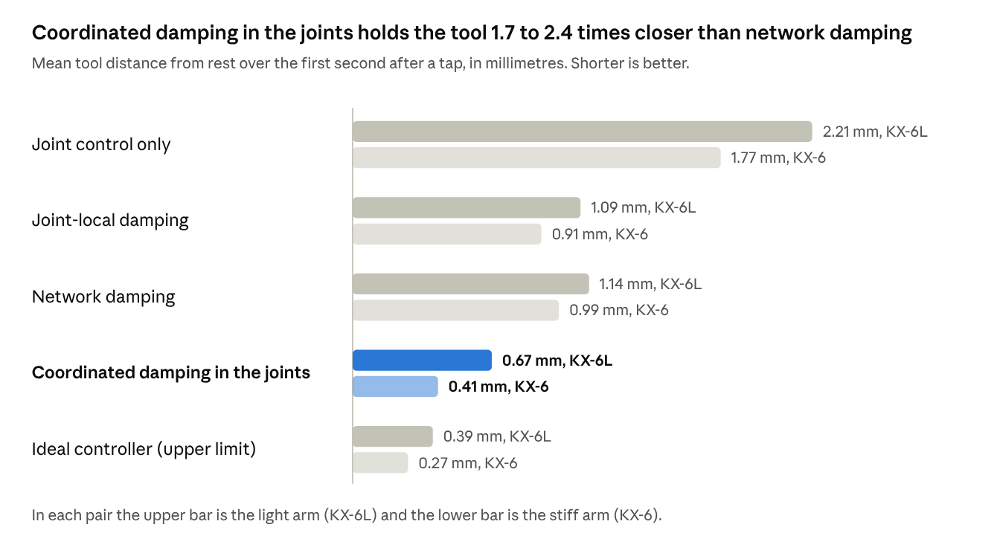
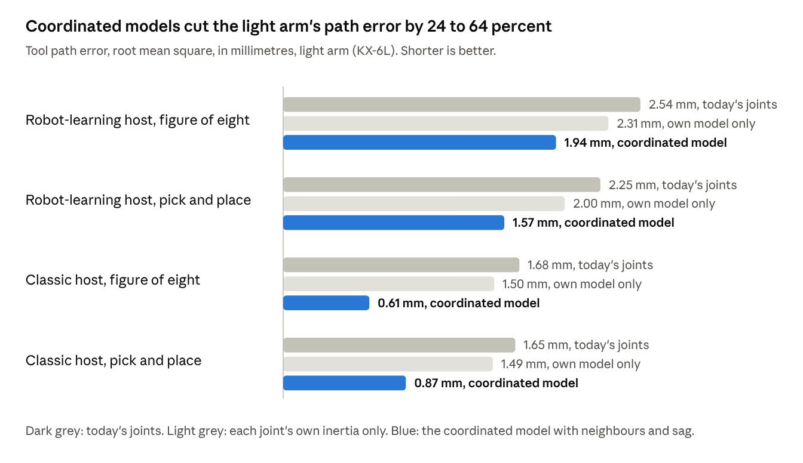

# Networked Actuators in Simulation: Final Report

22 October 2026

## Summary

We built a robot arm in simulation in which every joint is its own small computer, and the joints talk to each other over a shared cable. The joints sense, decide and act for themselves, and they share what they measure with their neighbours. Over 33 work packages, we tested whether this network of joints makes the arm safer, steadier and more accurate than joints that work alone. The answer is yes for safety and accuracy, and partly yes for damping vibration.

**Major highlights**

- **The host computer sends 30 times fewer messages.** When the joints plan their own motion between goals, the host sends 85 messages a second. When the host plans the motion itself, it sends about 2,560.
- **Learned actuator models cut drift 6.2 times on cheap actuators.** On budget actuators, each joint's learned model of itself reduced how far the joints strayed from the ideal arm during slow sweeps from 29.6 to 4.8 milliradians. On premium actuators the reduction was 2 times.
- **Shared neighbour data holds the tool 5 times closer to its target.** Each joint learned how its neighbours' motion loads it and how its own link bends under load. With that knowledge the light arm's tool held 0.45 millimetres from target on average, down from 2.21 millimetres, and its path error fell by up to 2.7 times.
- **Coordinated damping inside the joints holds the tool up to 2.8 times closer after a knock.** Each joint ran an estimator that listens to the joints up to two places away. On a clean bus this beat network damping by 1.3 to 2.8 times. A controller that sees every joint at once could reach 2.9 to 3.7 times.
- **Network damping settles vibration 2.0 to 2.5 times faster than the joints' own control.** The goal was 10 times, so this target was missed. A joint that damps with only its own sensors does about as well as the network version.
- **The network names a faulty joint in 100 out of 100 blinded trials.** On imperfect actuators, the learned models raised the correct answers from 20 to 29 out of 30.
- **Every joint reacts to an impact within one bus cycle**, which is a quarter of a millisecond. The arm can retreat and hold, or stop with its brakes, and it never stopped by mistake in 15 runs of fast motion.
- **The network never made the arm unstable.** An energy budget in each joint caps what its network signal can put into the arm. In the worst bus conditions tested, no joint put in more than 1.02 millijoules, which is about one fiftieth of its 50 millijoule budget.
- **Each joint can learn an actuator nobody described to it.** On an actuator type it had never seen, the learned model closed 61 percent of the gap to perfect knowledge, against a goal of 70 percent.

These results make a case for a network of smart actuators as the platform on which these algorithms run. The case is strongest for safety, for accuracy, and for taking work off the central computer. The case for faster settling rests on coordination between joints, which the network carries and which a simple neighbour-to-neighbour rule does not deliver by itself.

## What we did

We asked one question. Does an arm whose joints compute and coordinate among themselves beat the same arm run the usual way, by one central computer? To answer it, we built a simulation in which that question can be tested with numbers that anyone can reproduce.

**The arm.** The simulated arm has six joints and comes in two versions. The stiff arm, KX-6, has links that ring at about 10 hertz when knocked. The light arm, KX-6L, has thin carbon-tube links that weigh 60 percent as much, are ten times as flexible and ring at about 6 hertz. The light arm is the case a network of joints is meant to help. Its two long links can bend, and that bending is the vibration the joints try to calm.

**The joints.** Each joint is a quasi-direct-drive actuator: a motor with a low 9-to-1 gearbox, which the arm can push back through. Each joint carries an encoder on the motor and another on the output, a motion sensor (a gyroscope and an accelerometer), a current sensor and a temperature model. The joint's software is written in Rust, the language that would run on the real board. In the simulation, each joint runs as its own separate WebAssembly program. A joint sees only its own sensors and the messages that reach it over the cable, exactly as a real joint would.

**The cable.** The joints and the host computer share one bus modelled on EtherCAT, the industrial network that robot arms use. It runs 4,000 cycles a second. We can add delay, random delay and lost messages to it, to see what happens when the network is poor.

**The host.** The host plays one of two roles. As a robot-learning computer, it sends a goal pose 15 times a second, late and with jitter, the way a vision-language-action policy would. As a classic controller, it streams a precise setpoint to every joint 1,000 times a second. The host never computes damping, impact reactions or the joints' motion between goals.

**The physics.** MuJoCo, a widely used physics engine, simulates the arm, its gearboxes and its bending links. Hidden actuator models give each joint friction, cogging and gear play that its own software is never told about. This lets us test whether a joint can learn what it was not told.

We built the work in four stages, 33 work packages in all, each with its own written ticket, tests and record of results.

1. **Foundations.** We set up the physics, the sensors, the hidden actuator families, the joint software and the bus, and we checked each against known physics.
2. **The joint behaviours.** We built each behaviour the brief asked for: discovery of the joints on the bus, local position control, gravity compensation passed from the tip inward, motion planning inside each joint, damping with neighbour data, reporting a disturbance to the joint that causes it, impact reactions, limits and thermal headroom, and a learned model of each joint's own actuator.
3. **Proof and demo.** We wrote an automated proof that runs every test with fixed random seeds and writes a results report. We also built a browser demo that shows two identical arms side by side, each with its own settings, under the same knocks and the same tasks.
4. **Review and extension.** After the first review we added a classic controller as a second host, fixed three problems that review found, added cheap and expensive actuator grades, and then pursued the largest open question. We measured how much better any damping could do, found which vibrations no joint can reach, built coordinated damping across several joints, and finally taught each joint how its neighbours load it and how its link bends.

## The theory and the mathematics

This section states the models and control laws in one notation. Every formula here is the one the code runs or the one an experiment checked. The joints are numbered i = 1 to 6 from the base outward, and joint i+1 sits at the far end of the link that joint i turns.

### Notation

| Symbol | Meaning | Unit |
| --- | --- | --- |
| q\_i | Output angle of joint i, measured by its output encoder | rad |
| θ\_i | Motor angle of joint i, measured by its motor encoder and referred to the output side | rad |
| φ\_i = q\_i − θ\_i | Gear twist of joint i | rad |
| b\_i | Bend of the link that joint i turns, about the axis of joint i | rad |
| r\_i | Reference angle that joint i is asked to follow | rad |
| a\_i | Unit vector along the axis of joint i | none |
| ω\_i | Rotation rate of the housing of joint i, read by its gyroscope | rad/s |
| τ\_i | Torque that the motor of joint i applies, referred to the output | N·m |
| q | All the arm's coordinates together: motor angles, gear twists and link bends | rad |
| M(q) | The arm's mass matrix, which turns accelerations into the torques they need | kg·m² |
| H | The arm's stored energy: motion plus gravity plus springs | J |
| E\_i, E\_max | Energy in the budget ("tank") of joint i, and its ceiling of 50 mJ | J |
| Δt | One bus cycle, 0.25 ms | s |

A dot over a symbol means its rate of change in time. Two dots mean its acceleration.

### 1. The arm as a store of energy

The arm is a chain of rigid bodies joined by gearboxes, which act as stiff springs, and by bending joints in the middle of each flexible link. Its stored energy is the sum of its motion, its height in gravity and the energy held in its springs.

```math
H = \tfrac12\,\dot q^{\mathsf T} M(q)\,\dot q \;+\; V_{\text{gravity}}(q) \;+\; \tfrac12 \sum_i k_{\text{gear},i}\,\varphi_i^2 \;+\; \tfrac12 \sum_i k_{\text{link},i}\, b_i^2
```

The energy changes only through the power that the motors and any outside force put in, minus what friction and damping take out.

```math
\dot H = \sum_i \tau_i\,\dot\theta_i \;+\; P_{\text{outside}} \;-\; P_{\text{losses}}, \qquad P_{\text{losses}} \ge 0
```

This balance is the backbone of every stability argument below. A control law is safe in this sense when the power it feeds in can never exceed what has already been taken out.

### 2. Each joint's own position control

Each joint holds its reference with a spring, a damper and a slow integral term, plus the torques it already knows it needs: gravity and friction.

```math
\tau_i = K_i\,(r_i - q_i) + D_i\,(\dot r_i - \dot q_i) + K_{I,i}\!\int (r_i - q_i)\,dt + \tau_{\text{gravity},i} + \tau_{\text{friction},i} + \tau_{\text{damping},i}
```

The spring and damper act on the joint's own output angle and speed, measured where the torque acts. Control of this kind is called collocated, and it only ever takes energy out of the arm's motion. The last term is the extra damping that the network adds, described next.

### 3. Network damping

The housing of joint i+1 sits at the far end of the link that joint i turns. Its gyroscope therefore measures how fast the tip of that link turns. Seen from the housing of joint i, about its own axis, the tip turns at the joint's own speed plus the bending speed of the link.

```math
s_i = (\omega_{i+1} - \omega_i)\cdot a_i \;=\; \dot q_i + \dot b_i
```

Joint i subtracts the speed it was asked to move at, filters the result to the band where the arm vibrates, and damps it with a gain c\_i that grows with the inertia beyond the joint.

```math
\tau_{\text{damping},i} = -\,c_i\;\mathrm{F}\!\left[s_i - \dot r_i\right]
```

Here F stands for a high-pass filter followed by a low-pass filter. The neighbour's gyroscope reading reaches joint i over the bus, one or two cycles late.

### 4. Why the network term needs an energy budget

The power that the network term at joint i puts into the arm is its torque times the joint's own speed.

```math
P_i = \tau_{\text{damping},i}\,\dot q_i = -\,c_i\,\dot q_i^{\,2} \;-\; c_i\,\dot q_i\,\dot b_i
```

The first part always takes energy out. The second part has no fixed sign, because the joint's torque acts on its own angle and the signal also contains the bending of the link. At some vibration shapes the second part wins, and the joint then feeds the vibration. Our modal analysis found exactly this: on the light arm's 35.8 hertz mode, joint 2's network signal alone adds minus 12.4 percent damping.

Each joint therefore passes its network torque through an energy budget. The budget fills when the term takes energy out and empties when the term puts energy in. When it is empty, the term is switched off for that cycle.

```math
E_i(t+\Delta t) = \min\!\big(E_{\max},\; E_i(t) - \tau_{\text{damping},i}\,\dot q_i\,\Delta t\big), \qquad E_i \ge 0
```

The budget is measured with the joint's own sensors at the joint's own port. No delay, lost message or wrong neighbour reading can change it. Because each joint's own position control only ever takes energy out, the arm's energy is then bounded by its starting energy plus one full budget per joint.

```math
H(t) \;\le\; H(0) + N\,E_{\max} + \int_0^t P_{\text{outside}}\,dt
```

A colleague proposed a different argument, in which each joint damps the difference between its own gyroscope and each neighbour's, resolved into its own frame. That argument assumes the joint's torque power equals a sum of squares of those differences. It does not, for the same reason as above: a joint's torque works only on its own angle. Work package 32 ran that law as written and found that it puts energy into the arm at every gain tested.

### 5. Gravity passed from the tip inward

No joint holds the whole robot model. Each joint receives from its outer neighbour the mass M\_{i+1} and centre of mass c\_{i+1} of everything beyond it, adds its own link of mass m\_i with centre ρ\_i, and passes the sum inward.

```math
M_i = m_i + M_{i+1}, \qquad c_i = \frac{m_i\,\rho_i + M_{i+1}\,c_{i+1}}{M_i}, \qquad \tau_{\text{gravity},i} = a_i \cdot \big(c_i \times M_i\,g_i\big)
```

The gravity vector g\_i is measured in the joint's own frame by its accelerometer, steadied by its gyroscope. This keeps working when the base is tilted. When the arm holds still, the difference between the torque the joint actually holds and the torque this model predicts gives an estimate of the payload.

### 6. Each joint's learned model of its own actuator

Each joint learns a model of its motor and gearbox in port-Hamiltonian form. The model's energy has three parts: the rotor's motion, a cogging energy that repeats with the motor angle, and the gear's spring energy.

```math
H_{\text{joint}}(\theta, p, \varphi) = \frac{p^2}{2I} + V_{\text{cog}}(\theta) + V_{\text{gear}}(\varphi)
```

```math
\dot p = -\frac{\partial H}{\partial \theta} + \frac{\partial H}{\partial \varphi} - R(\omega)\,\omega + c\,\dot\varphi + g(T,\theta)\,u, \qquad R(\omega) \ge 0,\; c \ge 0,\; g > 0
```

Here p is the rotor's momentum, ω its speed, u the motor command and T the winding temperature. Small neural networks supply V\_cog, the correction to V\_gear, the friction R and the torque gain g. The positivity conditions are built into the networks, so the learned model can never create energy, whatever its weights.

```math
\dot H_{\text{joint}} = \omega\, g\, u + P_{\text{port}} - R\,\omega^2 - c\,\dot\varphi^{\,2}
```

The model is trained on the joint's own self-test data by matching the measured motor acceleration, after smoothing, and it is never told which actuator it sits on.

### 7. Coordinated damping with an estimator

The arm, held at rest, is linearised into a model that advances one bus cycle at a time. Its state z holds the arm's coordinates and speeds, the joints' own control, a model of friction, and a 40 hertz filter on the damping command. Measurements y arrive two cycles late.

```math
z_{k+1} = A\,z_k + B\,u_k + w_k, \qquad y_k = C\,z_{k-2} + v_k
```

Each joint runs a steady-state Kalman filter, which blends the model's prediction with each new measurement through a fixed gain L. It then applies its row of a gain K.

```math
\hat z_{k+1} = A\,\hat z_k + B\,u_k + L\,(y_k - C\,\hat z_{k-2}), \qquad u_k = -K\,\hat z_k
```

K is the linear-quadratic regulator gain, which minimises a weighted sum of the tool's squared distance from rest, its squared speed and the squared torques relative to each joint's rated torque. Each joint's filter reads only the joints up to two places away. The command passes through the same energy budget as network damping.

### 8. The coordinated model: what each joint learns from its neighbours

The torque that joint i's gearbox delivers to its link depends on how the joints around it accelerate. Joint i learns its own row of the arm's mass matrix over the joints up to two places away, written N\_i.

```math
\tau_{\text{gear},i} = \sum_{j \in N_i} m_{ij}(q)\,\ddot q_j + g_i(q), \qquad m_{ij}(q) = w_{ij}^{\mathsf T}\,\phi_{ij}(q)
```

The features φ\_ij are cosines and sines of the angles of the joints beyond the inner of i and j, and of their pairwise sums and differences. That restriction is a fact of every serial arm's mass matrix. The weights come from a least-squares fit on data in which every joint moved at once on its own frequencies.

The joint also learns how much its link bends per unit of torque, c\_i, from the bend that the two gyroscopes reveal.

```math
b_i(t) = \int \big(\omega_{i+1} - \omega_i\big)\cdot a_i\,dt - q_i(t) + \text{constant}, \qquad b_i \approx c_i\,\tau_{\text{gear},i}
```

In the joint, the model gives two corrections. The first is a torque for the motion its neighbours are about to make. The second is a shift of its reference that takes out half of its own link's predicted sag and half of its inner neighbour's.

```math
\tau_{\text{ff},i} = I_{\text{rotor},i}\,\ddot r_i + \sum_{j \in N_i} m_{ij}(r)\,\ddot r_j, \qquad \Delta r_i = -\tfrac12\,c_i\,\hat\tau_i \;-\; \tfrac12\,(a_i\cdot a_{i-1})\,c_{i-1}\,\hat\tau_{i-1}
```

Here τ̂\_i is the torque the joint expects to deliver: its gravity torque plus its feed-forward. The half-and-half split is exact for a link that bends at its middle, as the simulated links do. Both corrections are feed-forward, so they add no feedback loop and cannot make the arm unstable.

## Experimental setup

Every experiment runs the same joint software that would run on the hardware, one copy per joint, each seeing only its own sensors and the bus. Every number in this report comes from an automated proof run with fixed random seeds, so anyone can run it again and get the same numbers.

| Part | Setting used in the experiments |
| --- | --- |
| Arms | KX-6 (stiff links, rings at about 10 Hz) and KX-6L (light, flexible links, rings at about 6 Hz), each with six joints and a 3 kg payload at the tool unless stated otherwise |
| Postures | Home, stretched out ("reach"), and a posture between the two |
| Actuators | Quasi-direct drive with a 9-to-1 gearbox, as specified on the datasheet, or drawn from hidden families that the joint software is not told about |
| Hidden actuator families | Five open families (gear play, stiffening gear, ripple with thermal drift, position-dependent friction, textbook friction) and one sealed family kept back for the final test (friction with an internal state and an eccentric gear) |
| Actuator grades | Premium and budget versions of the same datasheet, the budget one with strong cogging, gear play and current-sensing errors |
| Encoders | 19 bits on the output, 14 bits on the motor (with the 9-to-1 gear this is 9 times finer at the output), with one count of noise |
| Motion sensor | Gyroscope with a bias of up to 0.5 degrees a second, accelerometer with a bias of up to 0.02 g |
| Bus | 4,000 cycles a second, one cycle of delay by default, and a budget of 3,125 bytes a cycle. Poor-bus tests add up to 20 cycles of delay, up to 4 cycles of random delay, and up to 20 percent lost messages |
| Robot-learning host | A goal pose 15 times a second, 30 milliseconds late on average with 15 milliseconds of jitter, and 5 percent of goals lost |
| Classic host | A setpoint to every joint 1,000 times a second |
| Central planning baseline | The host plans the motion itself at 250 cycles a second, with 10 percent of its ticks late |

**Tasks.** The arm follows three tasks: a figure of eight 15 centimetres across, a pick-and-place cycle with pauses, and a fast reach. Path error is the distance between the tool and where the task wants it at the same moment.

**Disturbances.**

- A tap is a push of 200 newtons at the tool for 10 milliseconds, upward or sideways.
- A shake is a sideways force of 15 newtons at the arm's first vibration frequency for 3 seconds.
- A push is a sideways force of 150 newtons for 0.4 seconds.
- A collision is the arm moving into a block held on a spring.
- A torque ripple is a periodic motor fault given to one joint, either 10 percent of rated torque, which the joint can cancel, or 50 percent, which it cannot.

**Measures.**

- Settling time is how long the tool takes to stay within 5 percent of its largest swing after a tap.
- Mean distance is the tool's average distance from rest over the first second after a tap.
- Time to stay within 0.5 millimetres is how long the tool takes to come back and stay within half a millimetre of rest.
- Path error is the root mean square of the tool's distance from the task path.
- Joint vibration is what each joint's gyroscope feels above 3 hertz, as a root mean square.
- Injected energy is the work that a damping term does on the arm, added up over time.

**Fairness rules.** Each damping mode used gains tuned for it on its own seeds, and the tests used other seeds that the tuner never saw. Models and designs were built at one posture and tested at others. The sealed actuator family was opened once, for the final run, and was never used to design or tune anything.

## The tests

We ran 16 tests of the original hypotheses and 7 further studies. Fifteen of the tests had a target set before any code was written. The sixteenth, H8, and the 7 studies report what they measure without a target. A test with a target counts as met only when every part of the target is met.

### Tests with targets

| Test | The question it asks | How it was run |
| --- | --- | --- |
| H1, settling | Does network damping bring the tool to rest at least 10 times faster than the joints' own control, and 3 times faster than each joint damping with its own sensors? | Taps upward and sideways at two postures on both arms, three unseen seeds each. We timed how long the tool took to settle within 5 percent of its largest swing. |
| H2, smooth motion | When the joints plan their own motion between goals, is the tool's jerk at least 5 times lower, with path error no worse? | Three tasks on the stiff arm with the robot-learning host. We compared joint-level planning with planning on the host at 250 cycles a second. |
| H3a, reaction speed | Do all joints react within two bus cycles of the first joint that detects an impact? | Three collisions. We counted the cycles between detection and each joint's reaction. |
| H3b, retreat and hold | Can an arm without brakes back away to where it was before the impact and hold there until a person confirms? | A collision with a block on a spring. We measured the return pose, the timing spread between joints, the force on the block, and any motion before confirmation. |
| H3c, stop with brakes | Does the brake stop follow the right order: slow down, close the brakes, then cut motor power? | A collision with the brake policy armed. We logged the times of each step and any sag afterwards. |
| H3d, configuration check | Do joints without a brake refuse the brake policy at start-up when they carry a gravity load? | The brake policy armed on an arm without brakes. We recorded which joints refused it and why. |
| H4, no false stops | Does the impact detector stay quiet during normal fast motion? | Five seeds of each of three fast tasks. We counted emergency stops. |
| H5, report to source | Can a joint with a motor fault recognise itself and cancel the fault, or report a fault to the host in time when it cannot? | A torque ripple of 10 or 50 percent of rated torque on joint 3 while it swept. We timed the claim, the correction and any fault report against a 2 second deadline. |
| H6, safe under a poor bus | Does network damping stay stable and put no net energy into the arm with up to 20 cycles of delay and 20 percent lost messages? | Taps under 15 bus conditions on each arm. We added up the work of every joint's network term. |
| H7, finding a faulty joint | In blind trials, does the network name the faulty joint at least 97 times in 100, and more often than the joints judging alone? | 100 trials in which a random joint got a gear ripple while all joints moved. A trial counts as right only when the faulty joint, and no other, claims the fault. |
| H8, work off the host | How much work moves from the host to the joints? | Reported without a target. We counted the host's inverse-kinematics solutions and messages per second. |
| H9, gravity from each joint's own sensors | Is each joint's gravity torque within 1 percent of rated, is the payload estimate within 5 percent, and does a tilted base cause less drift than with a model that assumes a level base? | Holds at rest with a 3 kg payload, a base tilted 15 degrees, and a base shaking at 1 hertz. |
| H10a, learning an unknown actuator | On the sealed actuator family, does the learned model close at least 70 percent of the gap between the datasheet model and perfect knowledge? | Each joint's self-test data for training and a second self-test at another pose for scoring. We compared the datasheet model, a least-squares fit, the learned model and the hidden truth. |
| H10b, the learned model helps the arm | Does the learned model make the arm behave more like an arm with ideal actuators? | Slow sweeps on three arms with hidden actuators. We measured how far the joints strayed from the ideal arm. |
| H10c, the learned model is passive | Does the learned model ever create energy? | The model's own energy balance, checked on the held-out data of 24 joints. |
| H10d, a wrong model cannot destabilise the arm | Does the arm stay stable with a deliberately wrong model? | Models with friction multiplied by 5, cogging reversed, or noise on every weight. |

### Studies without targets

| Study | The question it asks | How it was run |
| --- | --- | --- |
| Actuator grades | How do premium and budget actuators behave, and what do the network and the learned models change? | Taps, tasks and slow sweeps on each grade, with datasheet and learned models. |
| Headroom | How much better could any damping do? | An ideal controller that sees every coordinate of the arm with no delay, held to the joints' torque and energy budget. This is an upper limit that no joint can build. |
| Reach | Which vibrations can no joint reach at all? | The arm's vibration shapes from its linearised model. For each shape and each joint, we computed the damping that joint could add with its own sensors and with its network signal. |
| Coordinated damping | Can a gain designed for joints that each see two neighbours on either side match the ideal controller? | The gain run first on the arm's true state, then on what the bus carries. |
| Estimator in the joints | Does a filter that models delays and sensor noise make coordinated damping work on real bus data? | The estimator run outside the joints, then inside them, at three postures on a clean and on a lossy bus. |
| Coordinated models | Does each joint learning from its neighbours improve settling, tracking and steadiness? | First an upper limit from the simulator's true mass matrix. Then neighbourhood self-tests at ten postures, training, and runs inside the joints on tasks, holds, taps, a shake and a push. |
| A colleague's damping law | Does a proposed law with frame-aligned gyroscope differences always take energy out? | The law run as written with no energy budget, swept over gain and bus delay on both arms, and checked on the linearised arm. |

## Results

Of the 15 tests with a target, 10 met their target in full, 4 met part of it, and 1 missed it. The test without a target, H8, is reported as measured. The safety tests all passed. The miss is the most ambitious vibration target, and the studies that followed it show where the remaining gains lie.

### Scorecard

| Test | What we measured | Verdict |
| --- | --- | --- |
| H1, settling | Network damping settled the tool 2.03 to 2.45 times faster than the joints' own control, against a target of 10 times. It was 0.89 to 1.01 times as fast as each joint damping with its own sensors, against a target of 3 times. | Missed |
| H2, smooth motion | Joint-level planning cut path error in every task, by 2.1 to 4.7 times. It cut jerk by 2.0 and 2.7 times in two tasks and not at all in the fast reach, against a target of 5 times. | Partly met |
| H3a, reaction speed | The slowest joint reacted one bus cycle after detection, against a limit of two. | Met |
| H3b, retreat and hold | The tool returned within 0.36 mm of its pre-impact pose, all joints arrived in the same cycle, and the force on the block averaged 34.2 N, against 53.7 N for stopping in place. | Met |
| H3c, stop with brakes | The brakes closed 0.200 s after detection and motor power was cut at 0.250 s, with no sag afterwards. | Met |
| H3d, configuration check | Joints 2, 3 and 4, which carry gravity load and have no brake, refused the brake policy at start-up and gave the reason. | Met |
| H4, no false stops | No emergency stop occurred in 15 runs of fast motion. | Met |
| H5, report to source | A joint with a 10 percent ripple recognised itself and brought its neighbours' effort under 10 percent within 0.70 s. A joint with a 50 percent ripple reported a fault 2.05 s after its claim. | Met |
| H6, safe under a poor bus | The arm stayed stable in all 30 bus conditions. No joint's network term put in more than 1.02 mJ, against its budget of 50 mJ. | Met |
| H7, finding a faulty joint | The network named the faulty joint in 100 of 100 trials. The joints judging alone also scored 100, so the network could not do better on ideal actuators. | Partly met |
| H8, work off the host | The host sent 85 to 88 messages a second with joint-level planning and 2,558 to 2,792 with central planning. It solved the same 14 to 15 inverse-kinematics problems a second in both cases. | Reported |
| H9, gravity from each joint's own sensors | Three of six joints were within 1 percent of rated torque. The payload estimate was 10 percent heavy. A tilted base caused 0.37 mm of drift, against 4.93 mm with a level-base model. | Partly met |
| H10a, learning an unknown actuator | On the sealed family, the learned model closed 61 percent of the gap, against a target of 70 percent. The least-squares fit made things 5 percent worse. | Partly met |
| H10b, the learned model helps | Joints with learned models strayed 0.151 milliradians from the ideal arm, against 0.189 with the datasheet model and 1.682 with the least-squares fit. | Met |
| H10c, passive model | The learned model's losses were never negative, and its energy balance closed to within 1.4e-14 W on 24 joints. | Met |
| H10d, a wrong model is safe | With friction multiplied by 5, reversed cogging, or noise on every weight, the arm stayed stable and the network term stayed within its budget. | Met |

### Vibration: how close each approach holds the tool after a tap



*Source: [RESULTS.md](RESULTS.md), Headroom (NX-27) and Estimator (NX-30). Mean over home and reach postures, two tap directions, seeds 32 and 33.*

The ideal controller sees every coordinate of the arm with no delay, so no joint can build it. It marks the upper limit, and coordinated damping in the joints closes most of the gap between network damping and that limit on the stiff arm.

The joints' own position control already damps the arm's slow vibrations well, between 24 and 56 percent of critical damping. That is why the 10 times target, which assumed almost undamped vibrations, was out of reach for any single-joint rule. A joint that damps with its own sensors already captures most of the remaining gain. Network damping matches it in speed, with a sixth of its jitter at rest, because a gyroscope reading needs no differentiation.

The gains that remain come from coordination across several joints. A gain designed for each joint seeing two neighbours on either side matched the ideal controller when it was given the arm's true state, holding the tool 3.3 times closer than network damping on the light arm and 4.7 times closer on the stiff arm. Run on the raw bus data, that same gain was not robust. An estimator that models the bus delay, the sensor noise and the joints' own control fixed this. Running inside the joints on a clean bus, it held the tool 1.3 to 1.8 times closer than network damping on the light arm and 2.0 to 2.8 times closer on the stiff arm, at postures it was not designed for. On a bus that loses one message in five, the joints fall back to network damping and gain nothing.

The study of which vibrations each joint can reach found a hard limit. On the light arm, the links bend at 55 to 69 hertz in a way that crosses every joint axis. No joint's torque and no joint's sensor can reach that bending, so only the structure's own damping calms it.

The colleague's damping law, run as written with no energy budget, put energy into the arm at every gain we tried, and it made the arm unstable from our tuned gain upward, even with no bus delay. With every term given the sign of a damper, the term that looks at the inner neighbour still put energy in. The term that looks across the joint's own link took energy out at every gain up to four times our tuned gain, and it put energy in beyond that. This confirms why each joint keeps its energy budget.

### Accuracy: what the coordinated models change



*Source: [RESULTS.md](RESULTS.md), Neighbourhood (NX-31). Home posture, seeds 32 and 33, network damping on.*

The joint's own inertia alone cuts the path error by 9 to 11 percent. Adding what the joint learned from its neighbours brings the cut to 24 to 64 percent, and the largest gains come with the classic host, whose smooth setpoints leave the sag as the main error.

On the light arm, most of the gain comes from taking out the links' sag, which only the next joint's gyroscope can see. With the coordinated models, the tool held 0.28, 0.39 and 0.69 mm from its target at the three postures, against 1.49, 2.84 and 2.31 mm without them. On the stiff arm, whose links barely sag, each joint's own inertia did most of the work. Its path error fell by 16 to 50 percent, and the neighbours added up to 16 percent on top of the joint's own model. The models changed nothing after a tap, a shake or a push, because they act only on planned motion. Adding the estimator-based coordinated damping as well cut the tool's distance after a tap by 45 to 64 percent and reduced the shake response by 28 to 34 percent, without hurting tracking.

### Learning and fault finding

Each joint's learned model of its actuator worked best where the actuator has a clear structure. It closed 100 percent of the gap for gear play and 95 percent for a stiffening gear, and 33 to 57 percent for friction that changes with position or temperature. On budget actuators, the learned models cut how far the joints strayed from the ideal arm from 29.6 to 4.8 milliradians, and they cut the path error from about 25 mm to about 5 mm. On imperfect actuators, the learned models also raised the correct fault findings from 20 to 29 out of 30, because a joint that knows its own actuator stops mistaking its own quirks for a fault.

## Conclusion: the case for a network of actuators

The results make a solid case for a network of smart actuators as the platform on which these algorithms run. The case rests on four things that only a network of joints provides, and it comes with clear requirements for the network itself.

### What the network provides

1. **Measurements where they matter.** The motion sensor in each joint's housing sits at the far end of the previous link. That position lets the network see link bending that no single joint and no central model can see. Every gain in accuracy on the light arm came from this: the tool held 5 times closer to its target and tracked up to 2.7 times more accurately.
2. **Reactions at the speed of the bus.** Each joint detects an impact itself and every joint reacts within one bus cycle. The safety behaviours passed every test, and each joint checks the host's safety policy against its own hardware before the arm moves.
3. **Work spread across the joints.** The joints plan their own motion, compensate gravity from the tip inward, learn their own actuators and run their own estimators. The host sends 30 times fewer messages and does none of this work, which leaves it free for the task.
4. **Knowledge that each joint keeps about itself.** Each joint learns a model of its own actuator and of how its neighbours load it, from self-tests it runs itself. On budget actuators those models cut the path error from about 25 to about 5 millimetres, and they raised correct fault findings from 20 to 29 out of 30.

### What the network must provide

The algorithms that gave the largest gains place demands on the platform, and these demands define the infrastructure.

- **Every joint must hear every other joint.** Coordinated damping and the coordinated models read the joints up to two places away. On a six-joint arm this means each joint receives every state message.
- **Messages must arrive within about a millisecond.** The coordinated estimator needs each measurement within 4 bus cycles. With one message in five lost, it falls back to plain network damping and its extra gain disappears.
- **Each joint needs real computing power.** The coordinated damper runs a filter with 56 states and a model of about 10,000 numbers in every joint, 4,000 times a second.
- **Each joint needs a guaranteed energy limit.** Every network term passes an energy budget measured at the joint's own port. The test of the colleague's law shows what happens without it: the arm became unstable at ordinary gains.
- **Joints must publish their intent.** Each joint publishes its planned motion and its predicted link bend, so that its neighbours can prepare for them. In an earlier version the joints guessed each other's commands, and the arm oscillated.

### What the network alone does not deliver

A simple rule in which each joint damps against its neighbour's sensor settles the arm about as fast as a joint that damps with its own sensors. The 10 times target for faster settling was missed for that reason. The gains in vibration come from coordination designed for the whole arm, which the network carries and which the joints must compute. Some link vibrations cannot be reached by any joint at all and depend on the structure's own damping.

### Bottom line

A network of actuators makes the arm safer and more accurate, and it moves most of the control work out of the central computer. Its benefit grows with the amount of coordination the joints are given, and it depends on a bus that is fast and reliable and on joints with enough computing power to run estimators. That combination of fast bus, capable joints and a per-joint energy limit is the infrastructure this work argues for.

## Limitations

These results come from a simulation, and the simulation decides what they can and cannot show. We list here what a reader should keep in mind before carrying any number to hardware.

- **The links bend in one place.** Each flexible link is modelled as two rigid halves joined by a spring in the middle. Real carbon tubes bend along their whole length and have higher vibration modes that the model does not contain. The sag compensation's half-and-half split relies on this simple model, and a real link would need its own split.
- **The sensors are good models, and they are still models.** Encoders, gyroscopes and accelerometers have noise, bias and limited resolution here, chosen from datasheets. Mounting errors, temperature drift and electrical noise on a real board are not modelled.
- **Some targets were missed.** Settling reached 2.0 to 2.5 times faster against a target of 10 times. Three of six joints missed the 1 percent gravity target, because an accelerometer bias of 0.02 g reads as a 1.1 degree tilt and the payload's centre of mass is not estimated. The learned model closed 61 percent of the gap on the sealed actuator family against a target of 70 percent.
- **Coordination needs a good bus.** On a bus that loses one message in five, coordinated damping falls back to network damping and gains nothing over it.
- **The coordinated models belong to one arm and one payload.** Their inertia rows are fitted for the payload that the arm carried during its self-tests. A different payload, or postures far from the commissioned ones, needs new self-tests.
- **The energy budget is a bound and does not make damping good.** The budget guarantees that the network cannot run away with the arm. A term that stays inside its budget can still damp poorly, as the colleague's law showed at small gains.
- **The stability argument is an engineering argument.** It bounds the arm's energy through each joint's budget and is backed by tests under delay and message loss. It falls short of a formal proof when the reference moves, and it leaves out the link vibrations that no joint can reach.

## Recommended next steps

The next steps move the work toward hardware in order of risk, starting with the assumptions that the strongest results depend on.

1. **Measure the real links.** A modal test on a real carbon-fibre link would show its vibration modes and how it bends. In the simulation, splitting each link into several segments would show whether one bend per link is enough for the sag compensation and for the coordinated damper.
2. **Build a two-joint bench rig.** Two joints on one flexible link would test the core claim in hardware: that the outer joint's gyroscope reveals the link's bend rate, and that the learned compliance predicts the sag.
3. **Check the computing budget.** The coordinated damper's 56-state filter and 10,000-number model should be timed on the target microcontroller at 4,000 cycles a second.
4. **Make coordination survive a poor bus.** Each joint's filter should carry on through lost messages by predicting the missing measurement. Today it falls back to network damping.
5. **Calibrate the accelerometers and the payload.** A short calibration of each accelerometer's bias, and an estimate of the payload's centre of mass, would address the gravity torques that missed the 1 percent target.
6. **Teach the learned models time.** Training each joint's model on short forward simulations, which compare many time steps at once, should help with friction that has an internal state, where the sealed actuator family fell short.
7. **Extend the evidence.** Two smaller checks remain. The central planning baseline should also be run at 1,000 hertz without late ticks, and the coordinated models should be commissioned for more payloads.

## Glossary

| Term | Meaning in this report |
| --- | --- |
| Actuator | A joint's motor, gearbox, sensors and computer together |
| Bus | The shared cable over which the joints and the host exchange messages, 4,000 times a second |
| Bus cycle | One exchange of messages on the bus, a quarter of a millisecond |
| Collocated control | Control that acts on the same quantity it measures, such as a joint's torque acting on that joint's own angle. It only ever takes energy out. |
| Commissioning | A short self-test in which a joint moves on its own and records what it measures, to learn a model of itself |
| Coordinated damping | Damping in which each joint uses an estimate of the whole arm's motion, built from the joints around it |
| Coordinated model | What a joint learns about how its neighbours' motion loads it and how its own link bends |
| Energy budget (tank) | A per-joint account that lets the network term give back only the energy it has already taken out |
| Estimator, Kalman filter | A calculation that combines a model's prediction with noisy, delayed measurements to give the best estimate of the arm's motion |
| Feed-forward | A torque applied because a model predicts it will be needed, before any error appears |
| Gyroscope, accelerometer | The two halves of the motion sensor in each joint's housing: one measures how fast the housing turns, the other which way gravity points |
| Host | The central computer that sends goals and limits to the joints |
| Linear-quadratic regulator | A standard way to design a control gain that balances accuracy against the torque spent |
| Network damping | Damping in which a joint uses its neighbour's gyroscope to measure how the link between them moves |
| Port-Hamiltonian model | A model written in terms of stored energy and the power flowing in and out, which cannot create energy by its construction |
| Quasi-direct drive | A motor with a low gear ratio that the arm can push back through, so the motor current is a good measure of torque |
| Robot-learning host | A host running a vision-language-action policy, which sends goal poses about 15 times a second |
| Sag | How far a link bends under its own weight and the load it carries |
| Settling time | How long the tool takes to come to rest after a knock |
