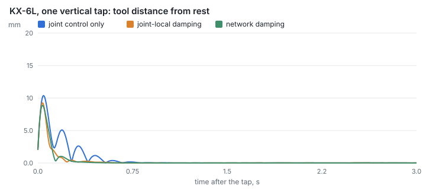
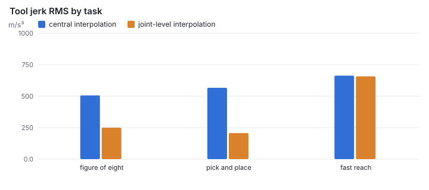
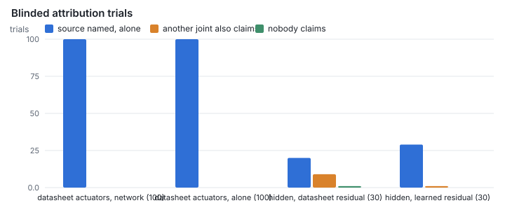
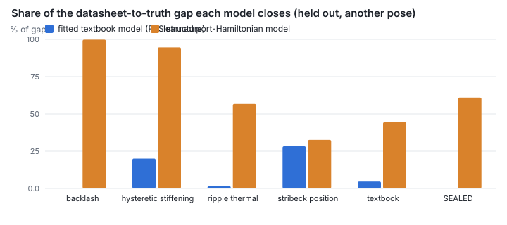
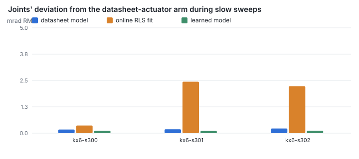

# Results

Generated by `npm run prove` (`experiments/src/prove.ts`) from the code in this
repository. Every number below is measured in simulation: the nodes are the Rust
joint code compiled to WebAssembly, one instance per joint, each seeing only its own
sensors and the bus. Targets come from the plan (docs/PLAN.md §3). Missed targets are
reported as missed.

| ID | Hypothesis | Target | Measured | Verdict |
|---|---|---|---|---|
| H1 | Networked damping settles vibration faster | ≥ 10× faster than network off, ≥ 3× than joint-local damping (worst posture) | KX-6L: 2.45× vs off, 0.89× vs local; KX-6: 2.03× vs off, 1.01× vs local | ✘ not met |
| H2 | Joint-level interpolation is smoother | Tool jerk ≥ 5× lower at equal or better path error | path error better in every task: yes; jerk ≥ 5× lower in every task: no | ◐ partly met |
| H3a | Every joint reacts to an impact fast | All joints react within 2 bus cycles of detection | slowest joint 1 cycle after detection (3 collisions) | ✔ met |
| H3b | P1 retreat and hold works without brakes | Pose within 1 mm, arrival spread ≤ 1 cycle, less contact force than stopping in place, no motion before ACK | pose 0.36 mm, spread 0 cycle, force 34.2 N vs 53.7 N, 0.01 mm before ACK | ✔ met |
| H3c | P2 E-stop works with brakes | Ramp, brake, then safe torque off, in that order; no sag beyond the brake model | brake +0.200 s, torque off +0.250 s after detection; sag 0.00 mm in the second after | ✔ met |
| H3d | Configuration check | P2 armed on a joint without a brake that carries gravity load is rejected at start-up, with a reason | rejected by joints 2, 3, 4 | ✔ met |
| H4 | No false stops | 0 E-stops during normal fast motion, N seeds | 0 false stops in 15 runs (5 seeds × 3 tasks) | ✔ met |
| H5 | Report to source works | Compensable ripple: helper effort under 10 % before the deadline (2 s). Non-compensable: fault at the host within the deadline | compensable: under 10 % 0.70 s after the claim, no fault; beyond budget: fault 2.05 s after the claim | ✔ met |
| H6 | Network damping is safe under bad bus conditions | Energy injected by the network term never positive; never unstable, latency up to 20 cycles and 20 % lost frames | never unstable: yes; largest cumulative work by any joint's network term 1.02 mJ (its tank holds 50 mJ) | ✔ met |
| H7 | Attribution | Correct source joint over 100 blinded fault trials: ≥ 97/100, and fewer errors than joints alone | network 100/100, joints alone 100/100; on hidden actuators 20/30 with the datasheet residual, 29/30 with the learned one | ◐ partly met |
| H8 | Work moves off the host | Reported (no target) | host computations per second, central / joint-level (below) | · reported |
| H9 | Each joint computes gravity correctly from its own IMU | Torque error ≤ 1 % of rated; drift with tilt clearly lower than a fixed-vertical model; payload within ±5 % | 3/6 joints within 1 %; tilt drift 0.37 vs 4.93 mm; payload 10 % | ◐ partly met |
| H10a | A PHNN learns an actuator nobody described | On the sealed out-of-family actuator: closes ≥ 70 % of the Nominal-to-Oracle gap and beats RLS | sealed: 61 % of the gap closed; RLS structure -5 % | ◐ partly met |
| H10b | The learned model improves the arm | PHNN measurably better than RLS; reported against Oracle | slow-sweep deviation from the datasheet-actuator arm: learned 0.151, datasheet 0.189, RLS 1.682 mrad (mean of 3 units) | ✔ met |
| H10c | The learned model is passive | Energy balance dH/dt ≤ input power on held-out trajectories; holds by construction, checked numerically | dissipation never negative (smallest 3.0e-11 W); balance closes to 1.4e-14 W on 24 joints | ✔ met |
| H10d | A wrong model can't destabilise the arm | Closed loop with a deliberately corrupted or mismatched model: never unstable; the energy tank caps the network term | bounded in every case: yes; network term within its tank: yes | ✔ met |
| Grades | Budget and premium actuators | Reported (NX-26): how each grade behaves, and what the network and the learned models change | network damping changes task vibration by −8 % (premium), +10 % (budget); learned models cut sweep deviation 1.95× (premium), 6.20× (budget) | · reported |
| Headroom | Headroom for learned damping | Reported (NX-27): how much better any damping could do after a tap | KX-6L: ideal 2.9× lower mean distance than network; KX-6: ideal 3.7× lower mean distance than network | · reported |
| Reach | Modes no joint can reach | Reported (NX-28): for each mode below 80 Hz, how much damping any one joint can add | reached by no joint: KX-6L home 55 Hz, KX-6L reach 67 Hz | · reported |
| Coordinated | Coordinated damping from joints two places away | Reported (NX-29): a gain designed for each joint seeing the joints up to two places away, on the true state and on what the bus carries | KX-6L: 3.3× closer than network on the true state; KX-6: 4.7× closer than network on the true state; from the bus alone, not yet robust | · reported |
| Estimator | Estimator-based coordinated damping | Reported (NX-30): a Kalman filter on the joints' frames and a designed gain, in the joints, against network damping | in the joints, after a tap, mean distance against network damping: clean bus KX-6L 1.3–1.8×, KX-6 2.0–2.8×; lossy bus KX-6L 1.0×, KX-6 1.0× | · reported |

## H1: Networked damping settles vibration faster

**Target:** ≥ 10× faster than network off, ≥ 3× than joint-local damping (worst posture)  
**Measured:** KX-6L: 2.45× vs off, 0.89× vs local; KX-6: 2.03× vs off, 1.01× vs local  
**Verdict:** ✘ not met

Mean settling time to the 5 % band, s (3 seeds × 2 tap directions; each mode with its own tuned gains):

| Arm | Posture | Joint control only | Joint-local | Network |
|---|---|---|---|---|
| KX-6L | home | 0.411 | 0.210 | 0.178 |
| KX-6L | reach | 0.581 | 0.211 | 0.237 |
| KX-6 | home | 0.431 | 0.161 | 0.203 |
| KX-6 | reach | 0.510 | 0.253 | 0.251 |

Network damping settles 2.03–2.45× faster than joint control alone, but against joint-local damping it is 0.89–1.01× at the worst posture: about even, and slower in some postures and seeds the tuner never saw (the tuner found it 1.1–1.3× faster at its own seeds, NX-11). The targets assumed an arm whose structural modes are almost undamped. A tuned joint servo already damps them well, and joint-local damping on the joint's own encoders gets most of what is left. What the network buys is that speed at about a sixth of joint-local damping's rest jitter (a gyro needs no differentiation) and a damping term whose energy is bounded by measured power (H6).

## H2: Joint-level interpolation is smoother

**Target:** Tool jerk ≥ 5× lower at equal or better path error  
**Measured:** path error better in every task: yes; jerk ≥ 5× lower in every task: no  
**Verdict:** ◐ partly met

Mean over 3 seeds; KX-6, 15 Hz policy with 30 ms latency, 15 ms jitter, 5 % lost steps; central host loop 250 Hz with 10 % late ticks.

| Task | Jerk RMS, central → joint-level | Ratio | Path error RMS |
|---|---|---|---|
| figure of eight | 506 → 250 m/s³ | 2.0× | 7.8 → 2.1 mm |
| pick and place | 567 → 207 m/s³ | 2.7× | 7.5 → 1.6 mm |
| fast reach | 663 → 658 m/s³ | 1.0× | 34.1 → 15.9 mm |

Joints rate-limit their reference to the host's speed limit, which also smooths the central setpoint stream; both modes run the same node code. Where the jerk target is missed, the arm's own 4 Hz servo bandwidth, not interpolation, limits how smooth the tool can be (NX-10).

## H3a: Every joint reacts to an impact fast

**Target:** All joints react within 2 bus cycles of detection  
**Measured:** slowest joint 1 cycle after detection (3 collisions)  
**Verdict:** ✔ met

The detecting joint stops at once and broadcasts the impact; every other joint reacts when the frame arrives (one cycle of bus latency).

## H3b: P1 retreat and hold works without brakes

**Target:** Pose within 1 mm, arrival spread ≤ 1 cycle, less contact force than stopping in place, no motion before ACK  
**Measured:** pose 0.36 mm, spread 0 cycle, force 34.2 N vs 53.7 N, 0.01 mm before ACK  
**Verdict:** ✔ met

| Measure | Retreat and hold | Stop in place |
|---|---|---|
| Mean force on the block over 0.5 s after detection | 34.2 N | 53.7 N |
| Force at the end | 0.4 N | 44.6 N |

Tool back at the pre-impact snapshot within 0.36 mm; all six joints holding within 0 cycle of each other; 6 impact faults reported to the host; goals ignored until the ACK (0.01 mm of motion), joints released after it: yes.

## H3c: P2 E-stop works with brakes

**Target:** Ramp, brake, then safe torque off, in that order; no sag beyond the brake model  
**Measured:** brake +0.200 s, torque off +0.250 s after detection; sag 0.00 mm in the second after  
**Verdict:** ✔ met

Each joint ramps its speed down (SS1-style), closes its brake, then pulls the hardwired safe-torque-off line.

## H3d: Configuration check

**Target:** P2 armed on a joint without a brake that carries gravity load is rejected at start-up, with a reason  
**Measured:** rejected by joints 2, 3, 4  
**Verdict:** ✔ met

Joints 2, 3 and 4 carry gravity load in the home pose and have no brake; joints 1 and 5 turn about vertical axes and joint 6's payload hangs along its axis, so they accept.

## H4: No false stops

**Target:** 0 E-stops during normal fast motion, N seeds  
**Measured:** 0 false stops in 15 runs (5 seeds × 3 tasks)  
**Verdict:** ✔ met

Detection compares each joint's external torque (gear torque minus what the IMU-measured motion of the links beyond needs) with thresholds commissioned at twice the largest seen in normal tasks (NX-16). Reaction armed on any joint; 4 kHz bus.

## H5: Report to source works

**Target:** Compensable ripple: helper effort under 10 % before the deadline (2 s). Non-compensable: fault at the host within the deadline  
**Measured:** compensable: under 10 % 0.70 s after the claim, no fault; beyond budget: fault 2.05 s after the claim  
**Verdict:** ✔ met

KX-6, joint 3 sweeping at 0.3 rad/s, torque ripple at the sixth electrical harmonic (order 864, about 41 Hz).

| Case | First claim | Fault at the host | Helper effort before | Under 10 % |
|---|---|---|---|---|
| compensable, corrected (10 % of rated) | 1.05 s | — | 0.536 N·m | 0.70 s after the claim |
| compensable, not corrected (10 % of rated) | 1.05 s | 3.10 s | 0.536 N·m | — |
| beyond budget, corrected (50 % of rated) | 1.75 s | 3.80 s | 0.960 N·m | — |

A joint claims a disturbance when its own motor-side residual shows the order clearly above a lock-in reference and a neighbour feels the order; it then cancels it by angle-locked feed-forward, capped at 20 % of rated torque. If a neighbour still feels it 2 s after the claim, the joint reports a fault.

## H6: Network damping is safe under bad bus conditions

**Target:** Energy injected by the network term never positive; never unstable, latency up to 20 cycles and 20 % lost frames  
**Measured:** never unstable: yes; largest cumulative work by any joint's network term 1.02 mJ (its tank holds 50 mJ)  
**Verdict:** ✔ met

Network damping with its tuned gains; a tap under each bus condition (seed 21), then a second tap with the work of every joint's damping term integrated.

| Arm | Latency, cycles | Lost frames | Settling, s | Peak, mm | Housing RMS, m/s² | Largest work, mJ |
|---|---|---|---|---|---|---|
| KX-6L | 1 | 0 % | 0.438 | 22.2 | 9.8 | 0.10 |
| KX-6L | 1 | 10 % | 0.439 | 22.2 | 9.8 | 0.10 |
| KX-6L | 1 | 20 % | 0.439 | 22.2 | 9.8 | 0.11 |
| KX-6L | 2 | 0 % | 0.439 | 22.3 | 9.8 | 0.15 |
| KX-6L | 2 | 10 % | 0.584 | 23.8 | 9.8 | 0.14 |
| KX-6L | 2 | 20 % | 0.583 | 23.8 | 9.8 | 0.14 |
| KX-6L | 5 | 0 % | 0.437 | 22.3 | 9.8 | 0.32 |
| KX-6L | 5 | 10 % | 0.440 | 21.4 | 9.8 | 0.44 |
| KX-6L | 5 | 20 % | 0.428 | 22.6 | 9.8 | 0.30 |
| KX-6L | 10 | 0 % | 1.197 | 26.2 | 9.8 | 0.00 |
| KX-6L | 10 | 10 % | 1.205 | 26.2 | 9.8 | 0.00 |
| KX-6L | 10 | 20 % | 1.193 | 26.2 | 9.8 | 0.00 |
| KX-6L | 20 | 0 % | 1.198 | 26.2 | 9.8 | 0.00 |
| KX-6L | 20 | 10 % | 1.198 | 26.2 | 9.8 | 0.00 |
| KX-6L | 20 | 20 % | 1.198 | 26.2 | 9.8 | 0.00 |
| KX-6 | 1 | 0 % | 0.426 | 18.9 | 9.8 | 0.41 |
| KX-6 | 1 | 10 % | 0.426 | 18.9 | 9.8 | 0.41 |
| KX-6 | 1 | 20 % | 0.426 | 18.9 | 9.8 | 0.46 |
| KX-6 | 2 | 0 % | 0.426 | 18.9 | 9.8 | 0.50 |
| KX-6 | 2 | 10 % | 0.561 | 19.9 | 9.8 | 0.46 |
| KX-6 | 2 | 20 % | 0.561 | 19.9 | 9.8 | 0.48 |
| KX-6 | 5 | 0 % | 0.425 | 18.9 | 9.8 | 0.77 |
| KX-6 | 5 | 10 % | 0.425 | 18.3 | 9.8 | 1.02 |
| KX-6 | 5 | 20 % | 0.421 | 19.1 | 9.8 | 0.69 |
| KX-6 | 10 | 0 % | 1.141 | 22.0 | 9.8 | 0.00 |
| KX-6 | 10 | 10 % | 1.147 | 22.0 | 9.8 | 0.00 |
| KX-6 | 10 | 20 % | 1.131 | 22.0 | 9.8 | 0.00 |
| KX-6 | 20 | 0 % | 1.139 | 22.0 | 9.8 | 0.00 |
| KX-6 | 20 | 10 % | 1.135 | 22.0 | 9.8 | 0.00 |
| KX-6 | 20 | 20 % | 1.136 | 22.0 | 9.8 | 0.00 |

The work can briefly be positive: the energy tank lets a joint give back what its damping term took earlier, never more than the tank holds. That is the passivity guarantee (ADR-0004). Beyond 2 ms of latency the network term switches itself off by design and the arm behaves like joint control alone.

## H7: Attribution

**Target:** Correct source joint over 100 blinded fault trials: ≥ 97/100, and fewer errors than joints alone  
**Measured:** network 100/100, joints alone 100/100; on hidden actuators 20/30 with the datasheet residual, 29/30 with the learned one  
**Verdict:** ◐ partly met

Each trial gives a random joint a gear-mesh ripple of 5–15 % of rated torque while every joint strokes at its own speed (1.0–1.6 rad/s). Right means the source, and only the source, claims it.

| Condition | Right | Wrong | Missed |
|---|---|---|---|
| Datasheet actuators, network | 100 | 0 | 0 |
| Datasheet actuators, joints alone | 100 | 0 | 0 |
| Hidden actuators, datasheet residual (network) | 20 | 9 | 1 |
| Hidden actuators, learned residual (network) | 29 | 1 | 0 |

Attribution rests on each joint's self-test of its own motor-side residual, which arm vibration cannot reach; joints alone run the same self-test, so on datasheet actuators the network cannot do better ("fewer errors than joints alone" is not met when neither makes any). What the network adds is the corroboration that the disturbance reaches the arm, the correction and the fault verdict. On actuators nobody described, the learned residual removes most false claims. Naming the source from felt vibration alone, the first design, named the wrong joint most of the time (NX-12).

## H8: Work moves off the host

**Target:** Reported (no target)  
**Measured:** host computations per second, central / joint-level (below)  
**Verdict:** · reported

Per second of task, central / joint-level:

| Task | IK solves | Setpoints or goals sent |
|---|---|---|
| figure of eight | 14 / 14 | 2558 / 85 |
| pick and place | 15 / 15 | 2558 / 88 |
| fast reach | 14 / 14 | 2792 / 85 |

Both modes solve the same IK per policy step; joint-level interpolation sends one goal per joint and step instead of a 250 Hz setpoint stream, and the joints interpolate.

## H9: Each joint computes gravity correctly from its own IMU

**Target:** Torque error ≤ 1 % of rated; drift with tilt clearly lower than a fixed-vertical model; payload within ±5 %  
**Measured:** 3/6 joints within 1 %; tilt drift 0.37 vs 4.93 mm; payload 10 %  
**Verdict:** ◐ partly met

| Measure | Target | Result |
|---|---|---|
| Gravity feed-forward error, joint 1 | ≤ 1 % of rated | 8.7 % (2.62 N·m) |
| Gravity feed-forward error, joint 2 | ≤ 1 % of rated | 0.1 % (0.05 N·m) |
| Gravity feed-forward error, joint 3 | ≤ 1 % of rated | 0.9 % (0.28 N·m) |
| Gravity feed-forward error, joint 4 | ≤ 1 % of rated | 7.9 % (0.79 N·m) |
| Gravity feed-forward error, joint 5 | ≤ 1 % of rated | 0.0 % (0.00 N·m) |
| Gravity feed-forward error, joint 6 | ≤ 1 % of rated | 12.2 % (1.22 N·m) |
| Payload mass (3 kg) | ±5 % | 3.29 kg (10 %) |
| Tool drift, base tilted 15° sideways | clearly lower than the level-base model | 0.37 mm vs 4.93 mm |
| Tool RMS, base accelerating 2 m/s² at 1 Hz | clearly lower than the level-base model | 1.10 mm vs 2.91 mm |

Why some joints miss 1 %: the base joint reads a 20 mg accelerometer bias as a 1.1° tilt, and the wrist joints assume the payload sits on the flange while it sits 5 cm beyond, which also makes the payload estimate heavy (NX-08). Estimating the payload's centre of mass and calibrating accelerometer offsets at commissioning would remove most of both.

## H10a: A PHNN learns an actuator nobody described

**Target:** On the sealed out-of-family actuator: closes ≥ 70 % of the Nominal-to-Oracle gap and beats RLS  
**Measured:** sealed: 61 % of the gap closed; RLS structure -5 %  
**Verdict:** ◐ partly met

Held-out commissioning run at another pose; RMS of the motor-side balance residual after 200 Hz smoothing, N·m (per family, the RMS over its joints). Nominal: datasheet. Fitted: least squares of the node's RLS structure. Oracle: the hidden truth through the same sensors.

| Family | Joints | Nominal | Fitted | PHNN | Oracle | PHNN closes | Fitted closes |
|---|---|---|---|---|---|---|---|
| backlash | 2 | 4.338 | 4.474 | 0.049 | 0.041 | 100 % | -3 % |
| hysteretic-stiffening | 5 | 2.630 | 2.153 | 0.378 | 0.250 | 95 % | 20 % |
| ripple-thermal | 3 | 1.102 | 1.092 | 0.719 | 0.428 | 57 % | 1 % |
| stribeck-position | 5 | 0.395 | 0.372 | 0.368 | 0.313 | 33 % | 28 % |
| textbook | 3 | 0.531 | 0.517 | 0.398 | 0.231 | 44 % | 5 % |
| **sealed (out of family)** | 6 | 2.911 | 3.033 | 1.350 | 0.350 | **61 %** | -5 % |

The sealed family (LuGre friction with an internal state, an eccentric gear) was written in NX-04, never used to design or tune anything, and opened once for the final run (NX-15). Two of its six joints end worse than the datasheet: the model has no internal friction state, and one commissioning run covers only part of the gear's eccentricity.

## H10b: The learned model improves the arm

**Target:** PHNN measurably better than RLS; reported against Oracle  
**Measured:** slow-sweep deviation from the datasheet-actuator arm: learned 0.151, datasheet 0.189, RLS 1.682 mrad (mean of 3 units)  
**Verdict:** ✔ met

Each unit is a KX-6 with hidden actuators and its committed models. The headline is how far the joints stray, during slow sweeps, from the same arm with datasheet actuators (the reference); task path errors and tap settling are shown for context.

| Unit | Model | Sweep deviation, mrad | Figure of eight, mm | Pick and place, mm | Tap settling, s |
|---|---|---|---|---|---|
| kx6-s300 | reference (datasheet actuators) | 0.000 | 2.52 | 1.90 | 0.280 |
| kx6-s300 | nominal | 0.170 | 2.55 | 1.93 | 0.292 |
| kx6-s300 | fitted | 0.355 | 2.51 | 1.93 | 0.294 |
| kx6-s300 | learned | 0.168 | 2.50 | 1.93 | 0.291 |
| kx6-s301 | reference (datasheet actuators) | 0.000 | 2.09 | 2.19 | 0.274 |
| kx6-s301 | nominal | 0.180 | 2.13 | 2.23 | 0.252 |
| kx6-s301 | fitted | 2.451 | 2.12 | 2.24 | 0.252 |
| kx6-s301 | learned | 0.143 | 2.11 | 2.24 | 0.271 |
| kx6-s302 | reference (datasheet actuators) | 0.000 | 2.13 | 3.21 | 0.276 |
| kx6-s302 | nominal | 0.219 | 2.20 | 3.21 | 0.290 |
| kx6-s302 | fitted | 2.239 | 2.17 | 3.27 | 0.291 |
| kx6-s302 | learned | 0.141 | 2.17 | 3.23 | 0.322 |

The H1 tap and H2 tasks barely change with any model: the stiff output-encoder servo already rejects most of what the actuators do differently. Where friction matters (slow motion), the learned feed-forward brings the arm closest to the reference; the online RLS fit chases what its structure cannot represent and can end worse than the datasheet.

## H10c: The learned model is passive

**Target:** Energy balance dH/dt ≤ input power on held-out trajectories; holds by construction, checked numerically  
**Measured:** dissipation never negative (smallest 3.0e-11 W); balance closes to 1.4e-14 W on 24 joints  
**Verdict:** ✔ met

Along the model's own vector field, Ḣ = ω·g·u + port power − R·ω² − c·φ̇², with R ≥ 0, c ≥ 0 and g > 0 by construction.

## H10d: A wrong model can't destabilise the arm

**Target:** Closed loop with a deliberately corrupted or mismatched model: never unstable; the energy tank caps the network term  
**Measured:** bounded in every case: yes; network term within its tank: yes  
**Verdict:** ✔ met

Unit kx6-s300, every joint's learned model broken the same way:

| Corruption | Sweep deviation, mrad | Figure of eight, mm | Tap settling | Rest motion after the tap, mm |
|---|---|---|---|---|
| friction x5 | 1.377 | 2.38 | 0.291 s | 0.012 |
| cogging x-10 | 0.747 | 2.71 | 0.163 s | 0.012 |
| noise on every weight | 10.195 | 8.12 | 0.473 s | 0.188 |

Never unstable, but not free: the feed-forward is in the loop through the measured motor angle, so cogging ten times too large and of the wrong sign acts like ten times the real cogging, and the tool chatters at rest. A wrong model degrades performance; the servo and the energy tank keep the arm bounded.

## Grades: Budget and premium actuators

**Target:** Reported (NX-26): how each grade behaves, and what the network and the learned models change  
**Measured:** network damping changes task vibration by −8 % (premium), +10 % (budget); learned models cut sweep deviation 1.95× (premium), 6.20× (budget)  
**Verdict:** · reported

KX-6. Ideal: datasheet actuators. Premium and budget: every joint drawn from the grade (`sim/src/actuators/grades.ts`); budget adds current-sensing offset (ripple once per electrical turn) and gain mismatch (twice per turn), strong cogging, stickier friction and gear play. Each grade's learned models were trained on its own commissioning run, like the open units.

**Damping**, with each joint's datasheet model and, for the graded units, its learned model. Tap: settling time to the 5 % band and peak; task: a figure of eight from the VLA computer, tracking RMS and the vibration joints 2–6 feel (mean, °/s RMS above 3 Hz):

| Grade | Tap, joint control only | Tap, network | Task, joint control only | Task, network |
|---|---|---|---|---|
| ideal, datasheet models | 0.515 s, 8.64 mm | 0.271 s, 7.37 mm | 2.60 mm, 7.55 °/s | 2.59 mm, 7.17 °/s |
| premium, datasheet models | 0.506 s, 8.64 mm | 0.260 s, 7.38 mm | 2.42 mm, 8.10 °/s | 2.39 mm, 7.46 °/s |
| premium, learned models | 0.506 s, 8.64 mm | 0.263 s, 7.38 mm | 2.43 mm, 8.08 °/s | 2.40 mm, 7.43 °/s |
| budget, datasheet models | 0.453 s, 9.26 mm | 0.697 s, 6.58 mm | 25.08 mm, 21.32 °/s | 25.37 mm, 23.36 °/s |
| budget, learned models | 0.394 s, 8.58 mm | 0.228 s, 7.03 mm | 5.37 mm, 20.16 °/s | 5.43 mm, 21.64 °/s |

**Models** (network damping). Sweep: how far the joints stray from the ideal arm during slow sweeps (mrad RMS); tasks: tracking RMS; tap: settling time:

| Grade | Model | Sweep | Figure of eight | Pick and place | Tap |
|---|---|---|---|---|---|
| ideal | datasheet | 0.000 | 1.86 mm | 1.62 mm | 0.279 s |
| premium | datasheet | 0.130 | 2.58 mm | 2.38 mm | 0.270 s |
| premium | learned | 0.066 | 2.58 mm | 2.38 mm | 0.275 s |
| budget | datasheet | 29.580 | 25.67 mm | 25.15 mm | 0.505 s |
| budget | learned | 4.770 | 4.94 mm | 4.50 mm | 0.226 s |

**Report to source.** 10 blinded trials per grade and model (a random joint gets a gear-mesh ripple of 5–15 % of rated; right / wrong / missed), and a figure of eight with nothing injected (joints that claimed a disturbance of their own, source faults):

| Grade | Residual | Trials right / wrong / missed | Nothing injected: claims | Faults |
|---|---|---|---|---|
| ideal | datasheet | 10 / 0 / 0 | none | 0 |
| premium | datasheet | 10 / 0 / 0 | none | 0 |
| premium | learned | 10 / 0 / 0 | none | 0 |
| budget | datasheet | 4 / 6 / 0 | J1, J2, J3, J5, J6 | 0 |
| budget | learned | 6 / 4 / 0 | J6 | 0 |

## Headroom: Headroom for learned damping

**Target:** Reported (NX-27): how much better any damping could do after a tap  
**Measured:** KX-6L: ideal 2.9× lower mean distance than network; KX-6: ideal 3.7× lower mean distance than network  
**Verdict:** · reported

Taps at rest as in H1 (two postures, two directions, unseen seeds). Per cell: mean tool distance from rest over the first second, time until the tool stays within 0.5 mm, peak. The ideal controller is an LQR on the linearised plant with the joints' own position loops, seeing every motor, gear and link-bending coordinate with no delay or noise, held to the joints' damping budget (a quarter of peak torque, a 50 mJ energy tank); its weighting was chosen per arm on one tuning tap. No joint can build it: it is an upper bound.

| Variant | KX-6L | KX-6 | KX-6, budget actuators |
|---|---|---|---|
| Joint control only | 2.206 mm, 0.564 s, 13.1 mm | 1.767 mm, 0.506 s, 10.9 mm | 1.882 mm, 0.469 s, 11.5 mm |
| Joint-local damping | 1.094 mm, 0.266 s, 11.6 mm | 0.906 mm, 0.219 s, 9.4 mm | 1.187 mm, 0.976 s, 10.0 mm |
| Network damping | 1.135 mm, 0.216 s, 11.3 mm | 0.990 mm, 0.225 s, 9.3 mm | 1.291 mm, 1.007 s, 8.4 mm |
| Ideal (whole state, no delay) | 0.385 mm, 0.077 s, 7.2 mm | 0.266 mm, 0.079 s, 5.2 mm | 0.480 mm, 1.525 s, 5.6 mm |
| Ideal without the energy tank | 0.348 mm, 0.075 s, 6.7 mm | 0.260 mm, 0.074 s, 5.2 mm | — |
| Ideal, one bus cycle late | 0.386 mm, 0.085 s, 7.2 mm | 0.275 mm, 0.079 s, 5.2 mm | — |
| Ideal, each joint seeing two joints either side | 0.423 mm, 0.097 s, 7.2 mm | 0.379 mm, 0.442 s, 5.3 mm | — |
| Ideal, each joint seeing its neighbours only | 0.555 mm, 0.821 s, 7.3 mm | 0.757 mm, 1.303 s, 5.1 mm | — |
| Network + neighbour coupling, κ = 0.1 | 1.102 mm, 0.216 s, 10.9 mm | 0.969 mm, 0.232 s, 9.0 mm | — |
| Network + neighbour coupling, κ = 0.3 | 1.073 mm, 0.246 s, 10.4 mm | 0.938 mm, 0.248 s, 8.5 mm | — |
| Network + neighbour coupling, κ = 1 | 2.836 mm, 1.607 s, 9.0 mm | 1.549 mm, 3.000 s, 7.4 mm | — |

The tank and a bus cycle of delay cost the ideal controller almost nothing: its advantage comes from acting on the whole arm's state at once, every joint coordinated, not from speed or from giving up passivity. The neighbour rows are NX-28: cutting the ideal gain to each joint's neighbours keeps part of the gain but leaves a slow tail, two joints either side gets most of it (a gain designed for the structure instead of cut from the full one does far better, even for neighbours only: see Coordinated, NX-29), and a damper between neighbouring joints (from a colleague's derivation; passive with fresh data) adds at most a few percent on top of network damping, and makes the arm ring when strong. On budget actuators, designed on the datasheet plant, it lowers the mean but is slow to stay within 0.5 mm: gear play and stiction are what a linear design ignores.

## Reach: Modes no joint can reach

**Target:** Reported (NX-28): for each mode below 80 Hz, how much damping any one joint can add  
**Measured:** reached by no joint: KX-6L home 55 Hz, KX-6L reach 67 Hz  
**Verdict:** · reported

The arm linearised where it holds (MuJoCo's accelerations, the joints' position loops closed), its modes from the full state matrix. For each mode, the damping ratio one joint adds on its own at its network-damping gain, to first order: with its own output rate (collocated), and with its network signal (outer gyro minus its own, on its axis). Filters and bus delay are left out: this is what the sensors can see at all. A negative value: that joint alone would feed the mode, not damp it; the network signal's 15 Hz low-pass and the energy tank are what keep that in check (ADR-0004).

| Arm | Posture | Mode, Hz | Damping held | Link bending | Largest one-joint effect, collocated | Largest one-joint effect, network | |
|---|---|---|---|---|---|---|---|
| KX-6L | home | 3.7 | 27.1 % | 1.5 % | J3 15.7 % | J3 17.7 % |  |
| KX-6L | home | 4.0 | 43.0 % | 0.7 % | J1 47.6 % | J1 47.6 % |  |
| KX-6L | home | 4.9 | 39.0 % | 0.3 % | J2 21.6 % | J2 22.8 % |  |
| KX-6L | home | 13.1 | 55.8 % | 0.0 % | J5 15.5 % | J5 15.5 % |  |
| KX-6L | home | 13.9 | 55.1 % | 0.2 % | J5 14.6 % | J5 14.6 % |  |
| KX-6L | home | 35.8 | 47.0 % | 42.0 % | J3 19.0 % | J2 -12.4 % |  |
| KX-6L | home | 50.3 | 27.4 % | 18.1 % | J4 4.8 % | J2 -10.7 % |  |
| KX-6L | home | 55.0 | 12.8 % | 97.9 % | J1 -0.4 % | J1 -0.4 % | no joint |
| KX-6L | home | 55.6 | 34.3 % | 74.1 % | J1 19.1 % | J1 19.1 % |  |
| KX-6L | reach | 3.0 | 24.0 % | 1.8 % | J2 11.9 % | J2 13.9 % |  |
| KX-6L | reach | 3.5 | 36.9 % | 1.8 % | J1 48.1 % | J1 48.1 % |  |
| KX-6L | reach | 5.3 | 46.8 % | 0.3 % | J4 31.5 % | J4 31.5 % |  |
| KX-6L | reach | 13.1 | 55.8 % | 0.0 % | J5 15.5 % | J5 15.5 % |  |
| KX-6L | reach | 35.0 | 51.2 % | 41.3 % | J2 22.3 % | J2 -18.7 % |  |
| KX-6L | reach | 38.4 | 50.4 % | 57.0 % | J1 41.9 % | J1 41.9 % |  |
| KX-6L | reach | 50.5 | 26.0 % | 18.4 % | J2 4.5 % | J2 -13.0 % |  |
| KX-6L | reach | 66.5 | 16.0 % | 84.8 % | J1 -0.2 % | J1 -0.2 % | no joint |
| KX-6 | home | 3.6 | 30.4 % | 0.0 % | J3 17.7 % | J3 17.9 % |  |
| KX-6 | home | 3.6 | 41.0 % | 0.0 % | J1 48.2 % | J1 48.2 % |  |
| KX-6 | home | 4.6 | 35.1 % | 0.0 % | J4 25.5 % | J4 25.5 % |  |
| KX-6 | home | 5.5 | 44.0 % | 0.0 % | J4 19.4 % | J4 19.4 % |  |
| KX-6 | home | 8.1 | 51.1 % | 0.0 % | J4 12.7 % | J4 12.7 % |  |
| KX-6 | home | 13.1 | 55.7 % | 0.0 % | J5 15.4 % | J5 15.4 % |  |
| KX-6 | home | 54.1 | 17.3 % | 0.1 % | J4 -2.8 % | J4 -2.8 % |  |
| KX-6 | home | 58.5 | 16.4 % | 0.3 % | J4 -3.0 % | J4 -3.0 % |  |
| KX-6 | home | 67.0 | 26.0 % | 3.8 % | J3 3.4 % | J2 -7.2 % |  |
| KX-6 | home | 69.1 | 29.3 % | 6.0 % | J3 3.8 % | J2 -7.0 % |  |
| KX-6 | reach | 2.9 | 27.3 % | 0.0 % | J2 15.3 % | J2 15.5 % |  |
| KX-6 | reach | 3.5 | 39.1 % | 0.0 % | J1 48.4 % | J1 48.4 % |  |
| KX-6 | reach | 5.0 | 46.8 % | 0.0 % | J4 32.1 % | J4 32.1 % |  |
| KX-6 | reach | 7.8 | 52.2 % | 0.0 % | J4 19.6 % | J4 19.6 % |  |
| KX-6 | reach | 13.1 | 55.7 % | 0.0 % | J5 15.4 % | J5 15.4 % |  |
| KX-6 | reach | 52.6 | 17.9 % | 0.1 % | J4 -3.3 % | J4 -3.3 % |  |
| KX-6 | reach | 58.8 | 16.4 % | 0.4 % | J4 -3.3 % | J4 -3.3 % |  |
| KX-6 | reach | 67.7 | 30.2 % | 5.4 % | J3 3.7 % | J2 -8.2 % |  |

Below 15 Hz the modes are the joints' own position loops, already 24–56 % damped, and the network signal reaches them about as well as each joint's own rate: one reason network and joint-local damping settle a tap about equally (H1). On the light arm, link bending at 55–69 Hz is reached by no joint (it bends across every joint axis); the structure's own damping (13–16 %) is all it has.

## Coordinated: Coordinated damping from joints two places away

**Target:** Reported (NX-29): a gain designed for each joint seeing the joints up to two places away, on the true state and on what the bus carries  
**Measured:** KX-6L: 3.3× closer than network on the true state; KX-6: 4.7× closer than network on the true state; from the bus alone, not yet robust  
**Verdict:** · reported

Taps as in NX-27 (two directions, unseen seeds), each cell the mean tool distance over the first second and the time until the tool stays within 0.5 mm. Gains designed at the home pose; the stretched-out pose is not designed for. All inside the joints' torque cap and energy tank.

| Variant | KX-6L, home | KX-6L, reach | KX-6, home | KX-6, reach |
|---|---|---|---|---|
| network | 0.721 mm, 0.173 s | 1.549 mm, 0.259 s | 0.667 mm, 0.190 s | 1.314 mm, 0.259 s |
| structured, neighbours, true state | 0.239 mm, 0.067 s | 0.626 mm, 0.141 s | 0.178 mm, 0.055 s | 0.417 mm, 0.102 s |
| structured, two either side, true state | 0.217 mm, 0.063 s | 0.586 mm, 0.136 s | 0.143 mm, 0.054 s | 0.370 mm, 0.096 s |
| structured, two either side, true state 3 cycles late | 0.310 mm, 0.064 s | 1.126 mm, 1.560 s | 0.327 mm, 0.055 s | 0.534 mm, 0.127 s |
| measured, two either side, from the bus | 0.476 mm, 0.173 s | 1.793 mm, 1.612 s | 0.669 mm, not within 3 s | 0.926 mm, 2.896 s |

Linear-model cost at home, relative to no gain: KX-6L: full 0.070, neighbours 0.103, two either side 0.073, two either side, 3 cycles late 0.079, measured from the bus 0.118; KX-6: full 0.023, neighbours 0.028, two either side 0.024, two either side, 3 cycles late 0.029, measured from the bus 0.038.

Designed for the structure (not cut from the full gain, as in NX-28), a gain that sees only the joints one or two places away matches the ideal controller on the true state, and holds up with three cycles of delay at the pose it was designed at. Run on the joints' state frames alone it is not yet robust: better than network damping at the home pose of the light arm, worse or oscillating elsewhere. The design treats the measurements as clean, delayed states; the joints' observers, the integration of the gyros and the position loops' actuation delay are not in its model. Not built into the node.

## Estimator: Estimator-based coordinated damping

**Target:** Reported (NX-30): a Kalman filter on the joints' frames and a designed gain, in the joints, against network damping  
**Measured:** in the joints, after a tap, mean distance against network damping: clean bus KX-6L 1.3–1.8×, KX-6 2.0–2.8×; lossy bus KX-6L 1.0×, KX-6 1.0×  
**Verdict:** · reported

Taps as in NX-27 (two directions, unseen seeds) at three postures; the model and gains built once, at the home pose. Each cell: mean tool distance over the first second, time to stay within 0.5 mm. Lossy bus: 20 % of frames lost, 4 cycles of jitter. In coordinated mode each joint filters the state frames of the joints up to two places away while it holds still, and uses network damping while it moves or when that data is late.

| Arm | Bus | Posture | network | estimator outside the joints, every frame | coordinated, in the joints |
|---|---|---|---|---|---|
| KX-6L | clean | home | 0.721 mm, 0.173 s | 0.393 mm, 0.103 s | 0.396 mm, 0.106 s |
| KX-6L | clean | reach | 1.549 mm, 0.259 s | 0.921 mm, 0.205 s | 0.939 mm, 0.205 s |
| KX-6L | clean | mid | 1.942 mm, 0.360 s | 1.410 mm, 0.330 s | 1.534 mm, 0.372 s |
| KX-6L | lossy | home | 0.822 mm, 0.217 s | 0.467 mm, 0.110 s | 0.831 mm, 0.217 s |
| KX-6L | lossy | reach | 1.830 mm, 0.351 s | 0.962 mm, 0.221 s | 1.847 mm, 0.350 s |
| KX-6L | lossy | mid | 2.490 mm, 0.503 s | 1.435 mm, 0.331 s | 2.496 mm, 0.477 s |
| KX-6 | clean | home | 0.667 mm, 0.190 s | 0.239 mm, 0.070 s | 0.240 mm, 0.070 s |
| KX-6 | clean | reach | 1.314 mm, 0.259 s | 0.557 mm, 0.128 s | 0.579 mm, 0.157 s |
| KX-6 | clean | mid | 1.539 mm, 0.263 s | 0.759 mm, 0.207 s | 0.783 mm, 0.204 s |
| KX-6 | lossy | home | 0.743 mm, 0.215 s | 0.320 mm, 0.069 s | 0.763 mm, 0.215 s |
| KX-6 | lossy | reach | 1.506 mm, 0.304 s | 0.615 mm, 0.127 s | 1.526 mm, 0.304 s |
| KX-6 | lossy | mid | 1.800 mm, 0.409 s | 0.793 mm, 0.208 s | 1.826 mm, 0.407 s |

The model is the arm linearised where it holds, with dry friction as damping of the fast part of the motor speed only, the joints' position loops and the damper's command (40 Hz low-pass) each a cycle late. On the lossy bus the joints are no better than network damping: a joint's filter needs the latest frame of every joint within its reach, no more than 4 cycles old, with the commands of its own cycle; with one frame in five lost and 4 cycles of jitter it often has not, and falls back to network damping. The same estimator outside the joints, on the frames as the host receives them, keeps its advantage there; what the joints lack is a way to carry on through missing frames.

Proof run took 43 min.
