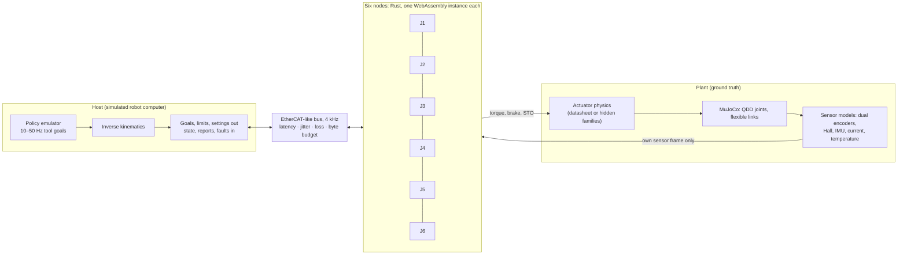

# Architecture

How the simulation is put together, and why a viewer can trust that the joints do the
work themselves. The decisions behind it are in the ADRs (`docs/adr/`).

## The boundary that matters

Each joint is a separate WebAssembly instance of the same `no_std` Rust crate
(`crates/nexus-node`), so each has its own memory. Every bus cycle, the harness writes
into that memory only the joint's own sensor frame and the bus frames delivered to it, and
reads back a torque, a brake request, the safe-torque-off line and the frames the joint
sent (`crates/nexus-wasm`, ADR-0002). A test (`sim/src/architecture.test.ts`) checks that
node-side code cannot import the plant, the actuator models or the analysis code.

## Inside a node

`Actuator` composes swappable stages, each behind a trait, in the order of one bus cycle:

| Stage | File | What it does |
|---|---|---|
| Estimator | `estimate.rs` | Dual-encoder twist, tracking observer for speed and acceleration |
| Bus handling | `actuator.rs`, `neighbours.rs` | Discovery, limits, settings, goals; neighbours' state and gravity chain |
| Dynamics models | `dynamics.rs`, `models.rs`, `phnn.rs` | Datasheet, online RLS fit, learned port-Hamiltonian model; friction feed-forward and the motor-side residual |
| Gravity | `gravity.rs` | "Up" from the IMU, a tip-inward chain of mass and centre of mass over the bus, payload estimate, external-torque residual |
| Impact | `impact.rs`, `supervisor.rs` | Detection on external torque; retreat-and-hold, E-stop with brakes, float; comm-loss watchdog |
| Interpolation | `reference.rs` | Quintic segments to cycle-stamped goals, or the host's setpoints |
| Commissioning | `excitation.rs` | Seeded multisine excitation inside the joint's limits |
| Control | `control.rs` | Output-encoder PD with gravity and friction feed-forward |
| Damping | `damping.rs` | Joint-local, or network damping on neighbours' IMU rates with an energy tank |
| Coordinated damping | `coordinated.rs` | While holding: a Kalman filter on the state frames of the joints up to two places away and a gain designed for the arm (loaded from the host), through the tank; network damping otherwise |
| Report to source | `source.rs` | Self-test of the motor-side residual, felt reports, claims, correction, deadline |
| Safety | `safety.rs` | Torque, position, speed and thermal limits, each announced as it acts |

## Wire

All frames are fixed-layout little-endian byte strings (`crates/nexus-proto`). The Rust and
TypeScript codecs are both checked against the same golden bytes
(`crates/nexus-proto/golden/frames.txt`). Kinds: state, goal, limits, announce, assign,
settings, gravity chain, impact, heartbeat, ack, fault, disturbance, commission.

## Harness and host

`sim/` is TypeScript and runs unchanged in Node (tests, `npm run prove`) and in the browser
(the demo). `ArmSystem` steps the plant, the sensor models, the bus, the host and the six
nodes once per 250 µs cycle. The host discovers the nodes, sends limits and settings, and
turns a policy's tool goals into joint goals. It never damps, detects, attributes or
interpolates for the joints (except in the "central interpolation" baseline of H2).

The host can play two kinds of robot computer, chosen per task (`InterpolationMode`):
- a **policy computer**: a VLA on a Thor-class machine, sending sparse goals at 10–50 Hz
  with latency, jitter and lost steps, which the joints interpolate;
- a **classic controller**: a deterministic real-time computer that runs the task as a
  program and streams a setpoint to every joint at 1–4 kHz, which the joints follow.

Starting a task switches the joints between the two through the settings frame. A
classic controller first moves to its program's start, so it can also take over
mid-motion (NX-22).

## Learning

`learning/` (Python) trains each joint's model of itself from that joint's own
commissioning log and exports frozen weights to `models/`. The node evaluates them in Rust.
Python never runs in the loop, and nothing learned sits in the safety path: the damping
law and its energy tank use measured power only. See [phnn.md](phnn.md).

## Proof and demo

- `npm run prove` (`experiments/src/prove.ts`) measures every hypothesis from fixed seeds
  and writes [RESULTS.md](RESULTS.md).
- `npm run dev -w web` runs the demo: two arms with the same harness, side by side.
